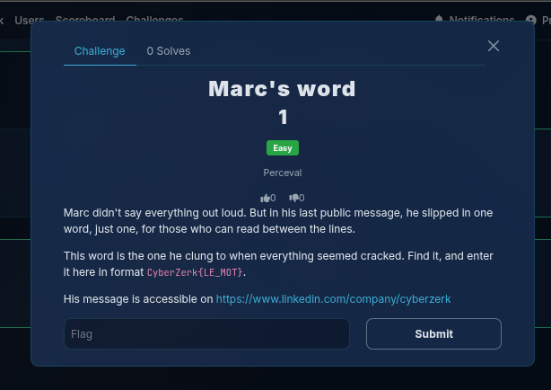

<h1 align="center">Marc's word — AWARENESS · 🟢 EASY</h1>

✅ <b>SOLVED</b> · 🩸 <b>FIRST BLOOD</b> · 📖 <a href="WRITEUP.md">Writeup</a>

<b>Alvo:</b> último post público da página LinkedIn da CyberZerk · <b>Vetor:</b> acróstico (primeira letra de cada parágrafo)

