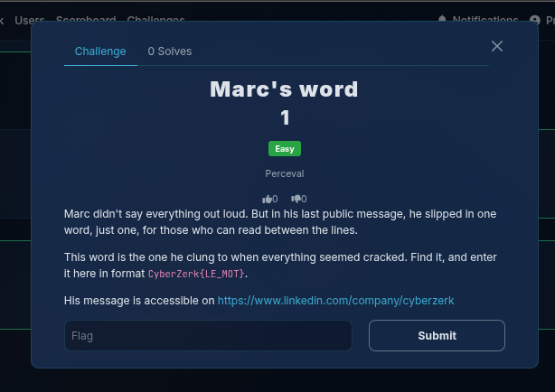

<div align="center">

<a href="https://git.io/typing-svg"></a>

</div>

# Marc's word — AWARENESS · 🟢 FÁCIL

- **Status:** ✅ RESOLVIDO — acróstico nos seis parágrafos do post de "Marc"; aceito na primeira tentativa.
- **Pontos:** 1 🩸 (first blood; valor exibido no card no momento da resolução, com 0 solves)
- **Alvo:** último post público da página [LinkedIn da CyberZerk](https://www.linkedin.com/company/cyberzerk), publicado em 21/11/2026, véspera do fim do CTF
- **Enunciado:** *"Marc didn't say everything out loud. But in his last public message, he slipped in one word, just one, for those who can read between the lines. This word is the one he clung to when everything seemed cracked. Find it, and enter it here in format `CyberZerk{LE_MOT}`."*
- **Flag:** `CyberZerk{ESPOIR}`

---

## TL;DR

1. O "artefato" é um post de LinkedIn da CyberZerk sobre saúde mental, dividido em duas vozes por um `---`: em cima fala "Marc", em primeira pessoa, e embaixo a associação.
2. "Lire entre les lignes" + "un mot, un seul" → a mensagem está na **forma** do texto: **acróstico**, a primeira letra de cada parágrafo.
3. Os seis parágrafos de Marc começam com **E**n, **S**e, **P**ourtant, **O**n, **I**l, **R**appelle-toi → `ESPOIR` ("esperança").

## Análise

### Triagem: onde está o desafio



O card aponta para a página LinkedIn da CyberZerk. O último post (21/11, véspera do encerramento) tem três elementos:

- o **texto** do post ([print](img/post-linkedin.png));
- um **visual** "Le signal dans le bruit" com uma forma de onda e o número 3114 ([print](img/visual-post.png));
- dois **links de doação** (`lnkd.in/…` → HelloAsso; `ctf.cyberzerk.fr/r/don`).

O P.S. confirma o alvo: *"Oui, c'est bien un indice pour le dernier challenge du CTF =)"*.

O enunciado fala de **uma palavra** que Marc "deixou escapar" na **mensagem**, para quem sabe **ler entre as linhas**. Isso aponta para o texto, não para a imagem nem para os links. Os links levam a páginas de doação da campanha Movember, sem nenhuma relação com o enigma.

### As duas vozes do post

O `---` separa o post em duas partes:

| Parte | Quem fala | Marca no texto |
|---|---|---|
| Acima do `---` | "Marc", em primeira pessoa | *"le jour où **j'en ai parlé**, à un collègue puis à un médecin"* |
| Abaixo do `---` | A associação | fim do CTF, agradecimentos, doações, P.S. |

O desafio pede a palavra **de Marc**, então só a parte de cima interessa.

### Acróstico

Lendo a margem esquerda dos parágrafos de Marc de cima para baixo:

| # | Início do parágrafo | Letra |
|---|---|---|
| 1 | **E**n cybersécurité, on passe nos journées à traquer les failles… | E |
| 2 | **S**e taire, c'est le réflexe qu'on apprend tôt… | S |
| 3 | **P**ourtant, le jour où j'en ai parlé, à un collègue puis à un médecin… | P |
| 4 | **O**n se croit seul. On ne l'est jamais autant qu'on le pense. | O |
| 5 | **I**l n'y a aucune honte à demander de l'aide… | I |
| 6 | **R**appelle-toi : en France, le 3114 répond 24h/24, gratuitement. | R |

`ESPOIR` = "esperança". Três checagens mostram que não é coincidência:

- **Cardinalidade:** são seis parágrafos e seis letras, formando uma única palavra, exatamente como diz *"un mot, un seul"*.
- **Semântica:** *"celui auquel il s'est accroché quand tout semblait fissuré"* descreve bem a esperança.
- **Fronteira:** se os parágrafos de baixo do `---` entram na leitura (**L**e CTF, **L**es dons, **P**.S), a palavra vira `ESPOIRLLP`, que não significa nada. O separador marca onde o acróstico termina.

A flag foi enviada crua, em maiúsculas e sem acento, como pede o formato `LE_MOT`. Isso segue a lição de [Hold on](../HoldOn/WRITEUP.md), em que a forma literal extraída do acróstico era a correta.

### Contexto

É o mesmo personagem (Marc_V) e a mesma técnica de [Hold on](../HoldOn/). Lá o relato dizia *"Tu n'es pas seul"* a Marc. Aqui é Marc quem conta que melhorou depois de falar com um colega e um médecin, e deixa na margem a palavra que o sustentou. A imagem "Le signal dans le bruit" resume a mecânica: o sinal (a palavra) está escondido no ruído (o texto corrido), e só aparece quando se muda o eixo da leitura.

## O que não funcionou

Não houve tentativa errada. As hipóteses abaixo foram descartadas por raciocínio, sem chegar a ser testadas:

| Hipótese | Resultado | Por quê |
|---|---|---|
| Esteganografia na imagem "Le signal dans le bruit" (forma de onda) | ✗ descartada | O enunciado fala de uma palavra no *message*, e o card é 🟢 Easy. A imagem só ilustra o conceito |
| Pista nos links de doação (HelloAsso, `/r/don`) | ✗ descartada | São páginas da campanha Movember, sem relação com Marc nem com o texto |
| Acróstico no post inteiro, incluindo a parte depois do `---` | ✗ | Dá `ESPOIRLLP`. O separador marca a troca de voz |
| Arsenal do `ctf-dispatch` | sem entrada | Nenhuma ficha cobre acróstico em texto. A solução veio direto do enunciado |

## Conclusão

Este é o último desafio do CTF, publicado na véspera do encerramento. A mecânica (acróstico) é a mesma de *Hold on*. O que muda é o suporte: um post público em rede social em vez de um arquivo anexo, o que obriga a separar a voz de Marc da voz da associação. A mensagem do desafio é a de todo o eixo Awareness: falar com alguém (um colega, um médico, o **3114**) é por onde a melhora começa, e **esperança** é a palavra que fica.

---

## Apêndice — método

Sem ferramenta: basta ler a primeira letra de cada parágrafo, de cima para baixo, até o `---`. Com o texto salvo em arquivo (um parágrafo por linha, linhas vazias removidas):

```bash
grep -v '^$' post.txt | sed '/^---/q' | grep -v '^---' | cut -c1 | tr -d '\n'; echo
# -> ESPOIR
```
