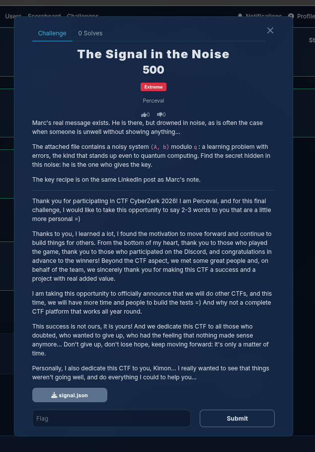

<div align="center">

<a href="https://git.io/typing-svg"></a>

</div>

# The Signal in the Noise — CRYPTO · 🟣 EXTREMO

- **Status:** ✅ RESOLVIDO — segredo LWE recuperado por reticulado; a tag AES-GCM validou a chave
- **Pontos:** 500 (valor inicial, 0 solves quando abri; confirmar após o envio)
- **Anexo:** `signal.json` (JSON, 39 KB, sha256 `c28859b7023925154b022223b488c86e325987a81742c72779047edf10f724aa`)
- **Enunciado:** *"Marc's real message exists. He is there, but drowned in noise, as is often the case when someone is unwell without showing anything... The attached file contains a noisy system (A, b) modulo q: a learning problem with errors, the kind that stands up even to quantum computing. Find the secret hidden in this noise: he is the one who gives the key. The key recipe is on the same LinkedIn post as Marc's note."* (seguido da mensagem de encerramento do Perceval)
- **Flag:** `CyberZerk{Par1er_Sauv3_D3s_V13s}`



---

## TL;DR

1. `signal.json` é uma instância **LWE** (Learning With Errors): `b = A·s + e (mod q)`, com `q = 3329` (o módulo do Kyber/ML-KEM), `A` 80×40 e o resultado cifrado em **AES-GCM** (`nonce`, `ct`, `tag`).
2. n = 40 é minúsculo para LWE. O ataque primal clássico (Kannan embedding + LLL/BKZ) **falhou**, porque o erro (‖e‖ ≈ 163) é maior que a heurística gaussiana da grade (≈ 120). O pivô foi supor um segredo **pequeno**, como no Kyber, e usar o embedding de **Bai-Galbraith**, cujo vetor alvo é `(e, s, 1)`. O BKZ-20 achou o alvo em 0,3 s: `s` ternário, com valores em {−1, 0, 1}.
3. Receita do post: chave = `SHA-256` dos coeficientes de `s` em decimal, separados por vírgula sem espaço. A tag GCM só validou com a representação **centrada** (`-1,0,1,...`). O plaintext é a mensagem de Marc com a flag.

## Análise

### O artefato

| Campo | Valor | Papel |
|---|---|---|
| `q` | 3329 | módulo (mesmo do Kyber) |
| `A` | 80 × 40, valores em [2, 3328] | matriz pública: m = 80 equações, n = 40 incógnitas |
| `b` | 80 valores | `A·s + e mod q` |
| `nonce` / `ct` / `tag` | hex | AES-GCM com a mensagem final |

Sem o erro `e`, Gauss mod q resolveria `s` na hora. Com `e`, cada eliminação soma e multiplica ruído, e o resultado vira lixo uniforme. O LWE se apoia nisso, e é por isso que ele é a base da criptografia pós-quântica. A fraqueza aqui é a **dimensão**: 40, contra 512 ou mais no Kyber real.

### A receita da chave

O enunciado diz que a receita está no mesmo post do LinkedIn que a mensagem de Marc (o post do challenge [Marc's word](../../Awareness/MarcsWord/)):

> a chave é o SHA-256 dos coeficientes secretos, em decimais, separados por vírgulas sem espaços

Ou seja, `key = sha256(",".join(str(c) for c in s))`. Uma ambiguidade ficou aberta: `s` em `[0, q)` ou centrado em `(−q/2, q/2]`. Ela é resolvida pela **tag GCM**, que serve de oráculo offline. Com a chave errada, `decrypt_and_verify` lança erro; com a certa, decifra. Assim nada é chutado: cada candidato é **verificado**.

### Tentativa 1: ataque primal (Kannan embedding) ✗

Os pontos "limpos" `A·s mod q` formam um reticulado q-ário. `b` fica a uma distância ‖e‖ de um desses pontos. O embedding de Kannan transforma "achar o ponto mais próximo" (CVP) em "achar o vetor mais curto" (SVP). A base tem estas linhas:

```
colunas de A  | 0        (40 linhas: combinações A·s)
q·I₈₀         | 0        (80 linhas: o "mod q")
b             | M        (1 linha)
```

O vetor curto esperado é `(e, M)`. Dali, `A·s = b − e` vira um sistema exato, que Gauss mod q resolve.

Para isso funcionar, o vetor alvo precisa ser bem menor que o espaçamento típico da grade. Esse espaçamento é a **heurística gaussiana**: √(d / 2πe) · det^(1/d), com d = 81 e det = q⁴⁰, o que dá **≈ 120**.

| Etapa | 3 menores normas | Melhor `(e, ±1)` |
|---|---|---|
| LLL | 227, 245, 251 | 251 |
| BKZ-10 | 189, 206, 208 | 234 |
| BKZ-20 | 164, 168, 169 | 199 |
| BKZ-30 | 160, 161, 162 | 167 |
| BKZ-40 | 149, 151, 153 | — |

Nenhuma etapa produziu um vetor **isolado**, bem mais curto que os vizinhos. Nos selftests sintéticos, o erro real sempre apareceu assim (ex.: 85 contra 138 com ruído ±16). Com o ‖e‖ real ≈ 163 > 120, o vetor alvo não se destaca dentro da grade. Por isso a hipótese "erro pequeno o bastante para o primal" foi **falsificada**, e um BKZ maior só gastaria tempo.

### Tentativa 2: Bai-Galbraith (segredo pequeno) ✓

No Kyber, `s` não é uniforme: ele vem de uma distribuição pequena (CBD). Se o desafio copiou isso, `s` também cabe no vetor curto. Para isso, a base ganha 40 coordenadas que carregam o próprio `s`:

```
−coluna_j de A | unitário_j | 0     (40 linhas)
q·eᵢ           | 0          | 0     (80 linhas)
b              | 0          | M     (1 linha)
```

O vetor alvo passa a ser `(e, s, M)`. A dimensão sobe para 121, e o determinante continua q⁸⁰. Com isso, a heurística gaussiana sobe para **≈ 567**. Como `s` é pequeno, o alvo quase não cresce: ‖(e, s)‖ ≈ ‖e‖ ≈ 163, bem abaixo de 567. Outra vantagem: `s` sai direto do vetor, sem precisar de Gauss.

| Etapa | 3 menores normas | Resultado |
|---|---|---|
| LLL / BKZ-10 | ~1700 | nada |
| **BKZ-20** | **163**, 1244, 1273 | vetor isolado → tag GCM **validou** |

Segredo recuperado (centrado), com 11 × −1, 14 × 0 e 15 × 1:

```
-1,0,1,-1,1,-1,0,0,0,-1,0,1,-1,1,1,1,0,1,1,1,0,1,0,1,0,1,-1,1,0,-1,0,-1,0,-1,-1,1,1,0,0,-1
```

Erro: `e ∈ [−32, 31]`, ‖e‖ ≈ 163.

### Plaintext

```
Message de Marc.

J'ai fini par en parler. A un collegue, puis a un medecin. Ca n'a pas tout regle d'un coup,
mais j'ai arrete de porter ca seul, et aujourd'hui ca va mieux. Si tu lis ca et que ca
resonne : parle-en. Demander de l'aide ce n'est pas un bug, c'est la mise a jour la plus
importante.

CyberZerk{Par1er_Sauv3_D3s_V13s}

-- En France : 3114, 24h/24, gratuit et confidentiel.
```

## O que não funcionou

| Hipótese | Resultado | Por quê |
|---|---|---|
| A receita está escondida na imagem do post ("Le signal dans le bruit") | ✗ | exiftool, binwalk, strings e planos de bit (Aperi'Solve) só mostram o JFIF e artefatos de JPEG q80. O LinkedIn recomprime e limpa a imagem. O `alt` é o padrão "Ver imagem". 120 barras na onda, sem relação com n = 40 nem m = 80 |
| A receita está nos links do post (HelloAsso / `ctf.cyberzerk.fr/r/don`) | ✗ | só a campanha Movember |
| Primal, aceitando o primeiro `(e, ±1)` do LLL | ✗ | ‖e‖ ≈ 272 > 120: vetor espúrio do reticulado. A checagem `b ≡ A·s + e` passava por **tautologia**, porque vale para qualquer vetor do reticulado. Quem prova é a tag |
| Primal com BKZ progressivo até 40 | ✗ | normas mínimas ~150 sem nenhum vetor isolado: o erro real (≈ 163) supera a heurística gaussiana (≈ 120) |

## Conclusão

O desafio é um "Kyber de brinquedo": mesmo q, segredo ternário, n = 40. Contra a abordagem ingênua, o ruído é grande o bastante para o ataque primal falhar. O que abriu a instância foi aproveitar o **segredo pequeno** com o embedding de Bai-Galbraith, que torna o vetor `(e, s, 1)` único na grade. Duas lições ficam. Primeiro, comparar a norma do alvo com a heurística gaussiana **antes** de reduzir diz se o ataque tem chance. Segundo, num sistema com AEAD, a tag é o único critério honesto de sucesso: equações que "fecham" não provam nada.

---

## Apêndice — ferramentas

- `solve.py` (requer `fpylll`, `cysignals` e `pycryptodome` num `.venv` local):
  - `.venv/bin/python -I solve.py --bg`: embedding de Bai-Galbraith com LLL e BKZ 10→50. Cada candidato é testado contra a tag GCM (`s` normal e centrado), e o plaintext é impresso.
  - `.venv/bin/python -I solve.py`: modo primal (Kannan), o que falhou aqui.
  - `.venv/bin/python -I solve.py --selftest [eta_e] [eta_s] [--bg]`: gera um LWE sintético do mesmo tamanho, com `s` conhecido, para validar o código. Exemplos: `--selftest 24 1 --bg` resolve no BKZ-10; `--selftest 24` (primal) não resolve.
- `img/visual-post.jpeg`: imagem do post salva do LinkedIn (analisada e descartada).
