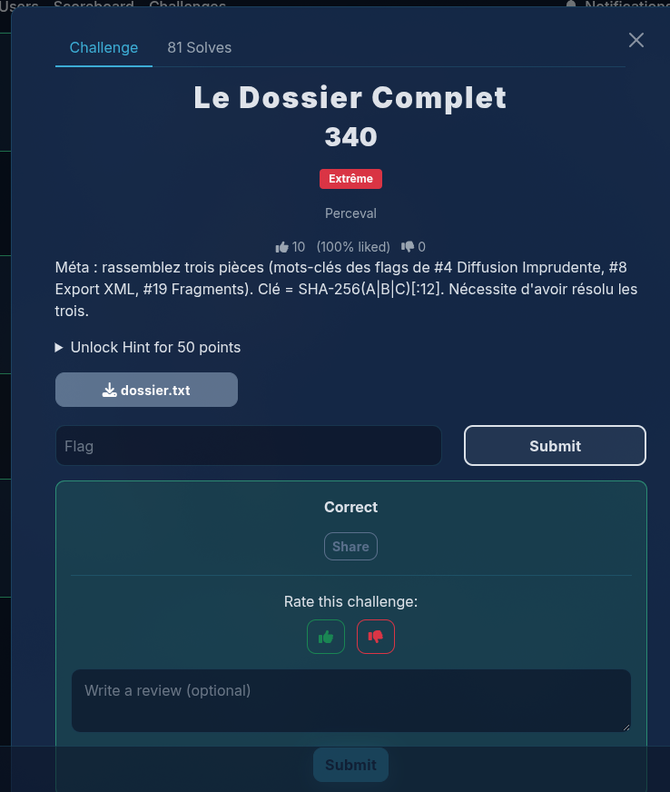

<div align="center">

<a href="https://git.io/typing-svg"></a>

</div>

# The Complete File (Le Dossier Complet) — MISC · 🟣 EXTREMO

- **Status:** ✅ RESOLVIDO — meta-challenge fechado com as flags de três challenges já resolvidos
- **Pontos:** 340 (dinâmico; 344 quando abri, 81 solves)
- **Anexo:** `dossier.txt` (texto com a receita)
- **Enunciado:** *"Méta : rassemblez trois pièces (mots-clés des flags de #4 Diffusion Imprudente, #8 Export XML, #19 Fragments). Clé = SHA-256(A|B|C)[:12]. Nécessite d'avoir résolu les trois."*
- **Flag:** `CyberZerk{DOSSIER_c0mpl3t_a2a34d87d580}`

---

## TL;DR

1. O `dossier.txt` dá a receita completa: juntar a palavra-chave central de três flags, calcular o SHA-256 e usar os 12 primeiros caracteres hex como chave.
2. Cada peça é o primeiro segmento legível da flag, antes do primeiro `_`, copiado exatamente como está (maiúsculas e leetspeak).
3. `SHA-256("Hastad|XXE|c4rv1ng")[:12]` = `a2a34d87d580`, que vai em `CyberZerk{DOSSIER_c0mpl3t_<clé>}`.

## Análise

### A receita (`dossier.txt`)

```text
Clé du dossier = SHA-256( A + '|' + B + '|' + C ), 12 premiers hex.
Flag = CyberZerk{DOSSIER_c0mpl3t_<clé>}
```

Não tem nada escondido: é só cálculo local. A dificuldade "Extrême" vem dos pré-requisitos, porque é preciso ter resolvido os três challenges, e não do cálculo em si. Também não precisei da dica paga (50 pts).

### As três peças

| Peça | Challenge (nome FR → pasta) | Flag | Palavra-chave |
|---|---|---|---|
| A | Diffusion Imprudente → [`Cryptography/RecklessBroadcast`](../../Cryptography/RecklessBroadcast/) | `CyberZerk{Hastad_br0adcast_3_d3st1nat41r3s_1_m3ss4g3}` | `Hastad` |
| B | Export XML → [`Web/ExportXml`](../../Web/ExportXml/) | `CyberZerk{XXE_f1l3_pr0t0c0l_l1t_l3_fich13r_d3s_c0ng3s}` | `XXE` |
| C | Fragments → [`Forensic/Fragments`](../../Forensic/Fragments/) | `CyberZerk{c4rv1ng_l3_PNG_surv1t_a_l_3ff4c3m3nt}` | `c4rv1ng` |

As palavras-chave resumem o vetor de cada challenge: ataque de broadcast de Håstad (RSA com `e = 3`), XXE e carving de PNG.

### A chave

```bash
printf '%s' 'Hastad|XXE|c4rv1ng' | sha256sum | cut -c1-12
# a2a34d87d580
```



## O que não funcionou

| Hipótese | Resultado | Por quê |
|---|---|---|
| `echo 'Hastad\|XXE\|c4rv1ng' \| sha256sum` | ✗ `96bc9354ad71` | O `echo` acrescenta `\n` no fim, e um único byte a mais muda o hash inteiro (efeito avalanche). Por isso usei `printf '%s'`. |

O `echo` não cheguei a enviar: testei de propósito, localmente, para mostrar a armadilha.

## Conclusão

Um meta-challenge que premia ter feito o trabalho antes. Os únicos pontos de atenção são copiar as peças sem normalizar nada (não trocar maiúsculas nem desfazer o leetspeak) e calcular o hash sem quebra de linha no final.
