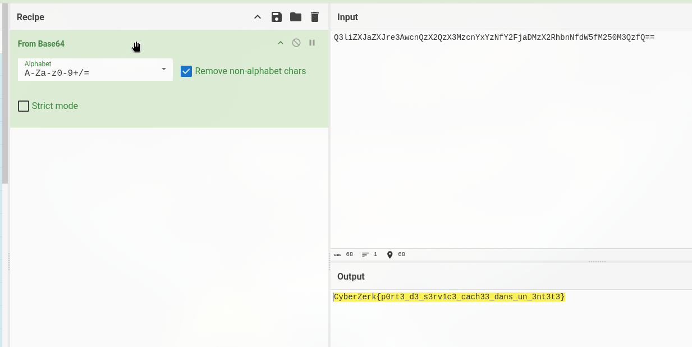
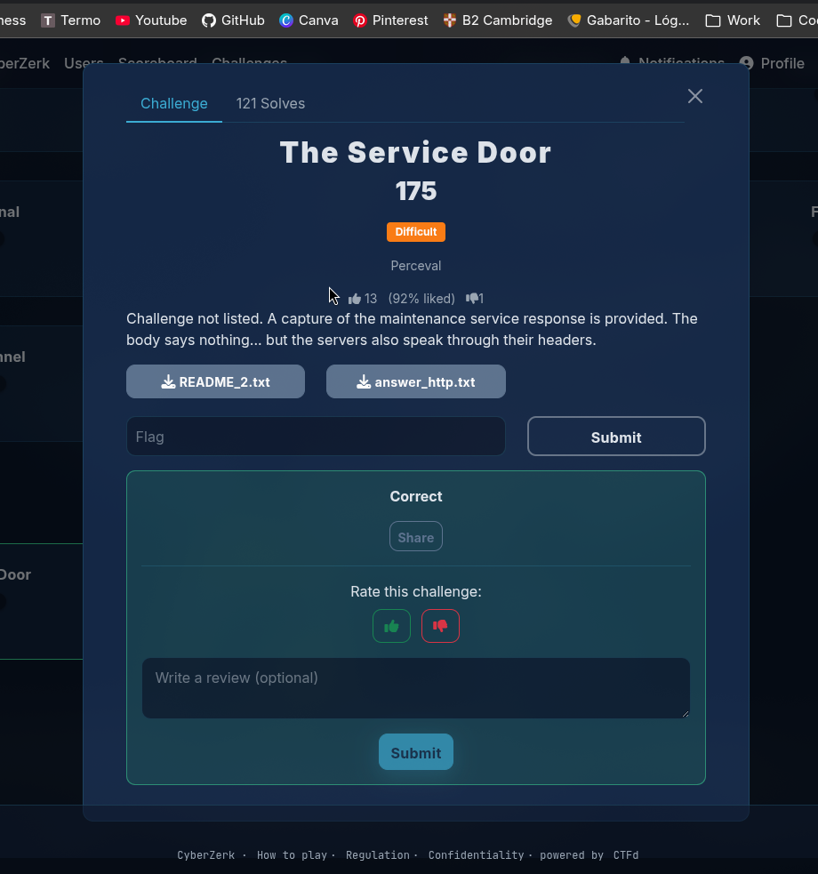

<div align="center">

<a href="https://git.io/typing-svg"></a>

</div>

# The Service Door — MISC · 🔴 DIFÍCIL

- **Status:** ✅ RESOLVIDO — cabeçalho HTTP customizado com a flag em Base64.
- **Pontos:** 175 (valor dinâmico no momento da resolução; selo "Difficult" na plataforma)
- **Anexo:** `reponse_http.txt` (na plataforma aparece como `answer_http.txt`; captura de requisição/resposta HTTP) + `README_2.txt`
- **Enunciado:** *"Challenge not listed. A capture of the maintenance service response is provided. The body says nothing... but the servers also speak through their headers."*
- **Flag:** `CyberZerk{p0rt3_d3_s3rv1c3_cach33_dans_un_3nt3t3}`

---

## TL;DR

1. O anexo é uma resposta HTTP capturada. O corpo (`maintenance en cours`) não tem nada.
2. Um único cabeçalho fora do padrão, `X-Service-Door`, carrega um valor em Base64.
3. Aplicar `From Base64` dá a flag: *"porte de service cachée dans un en-tête"* ("porta de serviço escondida num cabeçalho").

## Análise

### Anatomia da resposta

Uma mensagem HTTP tem **linha de status**, **cabeçalhos** (`Nome: valor`, um por linha), uma **linha em branco** e o **corpo**. O usuário só vê o corpo, mas os cabeçalhos também chegam ao cliente e qualquer um consegue lê-los (DevTools → Network, `curl -i`, Burp).

| Cabeçalho | O que é |
|---|---|
| `Date`, `Server`, `X-Powered-By` | padrão (os dois últimos vazam versão: Apache 2.4.58 / PHP 8.3.6, um *fingerprint* comum) |
| `Cache-Control`, `Content-Type`, `Content-Length` | padrão |
| `X-Frame-Options`, `Set-Cookie` | padrão (anti-clickjacking; cookie de sessão apagado com `expires` em 1970) |
| **`X-Service-Door`** | **customizado**: o prefixo `X-` marca cabeçalho fora do padrão, e o nome repete a *"porte de service laissée ouverte"* do README |

O corpo tem exatamente os 41 bytes declarados em `Content-Length` (o `—` ocupa 3 bytes em UTF-8), então não há nada escondido depois dele.

### Reconhecer o Base64

```
Q3liZXJaZXJre3AwcnQzX2QzX3MzcnYxYzNfY2FjaDMzX2RhbnNfdW5fM250M3QzfQ==
```

- O alfabeto é só `A–Z a–z 0–9 + /`, com `=` de padding.
- 68 caracteres, múltiplo de 4. 17 blocos × 3 bytes = 51, menos 2 de padding (`==`) = **49 bytes**, o tamanho da flag.
- O prefixo `Q3liZXJaZXJr` é sempre o Base64 de `CyberZerk` (ver [Distress Signal](../../Awareness/DistressSignal/WRITEUP.md)).

### Decodificação

CyberChef → `From Base64` (alfabeto padrão):



```
CyberZerk{p0rt3_d3_s3rv1c3_cach33_dans_un_3nt3t3}
```



## O que não funcionou

Nada deu errado. A hipótese "o segredo está no cabeçalho incomum" foi a primeira e já se confirmou. O corpo foi descartado pelo hint e pelo `Content-Length` coerente.

## Conclusão

O selo "Difficult" exagera: é uma operação só. A lição de segurança é real, porém: **cabeçalhos de resposta são públicos**. Cabeçalho de debug, "porta de serviço", token ou versão de software não podem ir para produção, porque o atacante lê tudo sem precisar enviar nenhum payload. Na prática, um `curl -i` ou a aba Network é o primeiro passo de qualquer recon web.

---

## Apêndice — comando

```bash
grep '^X-Service-Door:' reponse_http.txt | cut -d' ' -f2 | tr -d '\r' | base64 -d; echo
# -> CyberZerk{p0rt3_d3_s3rv1c3_cach33_dans_un_3nt3t3}
```
