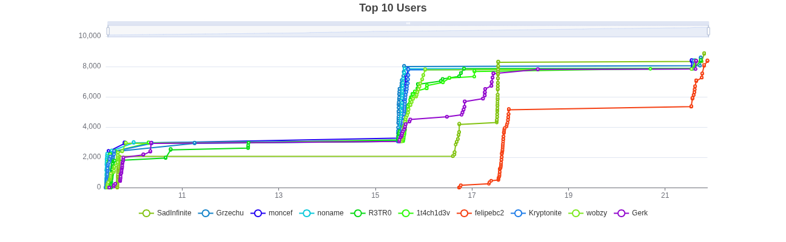

<b>🇧🇷 Português</b>

<h2>CYBERZERK CTF 2026</h2>

Writeups e artefatos dos desafios do <b>CTF CyberZerk 2026</b>, organizado pela associação CyberZerk (França), online e individual.

  <b>Plataforma:</b> <a href="https://ctf.cyberzerk.fr/challenges"><code>ctf.cyberzerk.fr</code></a> 
  <b>Formato:</b> jeopardy individual · pontuação dinâmica · flag <code>CyberZerk{...}</code> 
  <b>Data:</b> 09/11/2026 14:00 → 22/11/2026 18:00 (horário de Paris) = 09/11 10:00 → 22/11 14:00 (horário de Brasília) · <b>Encerrado</b> 
  <b>Regulamento:</b> <a href="docs/regulamento.md"><code>docs/regulamento.md</code></a> · <b>Confidencialidade:</b> <a href="docs/confidencialidade.md"><code>docs/confidencialidade.md</code></a>

<b>Resultado:</b> 🏅 <b>7º lugar (ex aequo) de 801</b> · 8385 pontos · 53 flags · <a href="docs/certificado-cyberzerk-2026.pdf">certificado</a> (ID <code>CZ26-RSWC-YQ5T</code>) 
<b>Writeups oficiais:</b> <a href="https://github.com/Association-CyberZerk/write-ups-ctf-cyberzerk-2026">Association-CyberZerk/write-ups-ctf-cyberzerk-2026</a>

Os challenges de Warm-up e Signature ficam na pasta <code>Miscellaneous/</code>. As tabelas estão na seção em inglês abaixo. Todos os writeups seguem o <a href="WRITEUP_TEMPLATE.md"><code>WRITEUP_TEMPLATE.md</code></a>.

<h1>CYBERZERK CTF 2026</h1>

Writeups and artifacts for the <b>CyberZerk CTF 2026</b>, run by the CyberZerk association (France): an online, individual competition.

  <b>Platform:</b> <a href="https://ctf.cyberzerk.fr/challenges"><code>ctf.cyberzerk.fr</code></a> 
  <b>Format:</b> individual jeopardy · dynamic scoring · flag <code>CyberZerk{...}</code> 
  <b>Date:</b> November 9, 2026 14:00 → November 22, 2026 18:00 (Paris time) · <b>Finished</b> 
  <b>Official writeups:</b> <a href="https://github.com/Association-CyberZerk/write-ups-ctf-cyberzerk-2026">Association-CyberZerk/write-ups-ctf-cyberzerk-2026</a>

<h2>Final result</h2>
<table>
  <tr><th>Player</th><th>Rank</th><th>Score</th><th>Solved</th><th>Certificate</th></tr>
  <tr><td><a href="https://github.com/Felipebc2">Felipebc2</a></td><td>🏅 7th (ex aequo) / 801</td><td>8385</td><td>53</td><td><a href="docs/certificado-cyberzerk-2026.pdf">CZ26-RSWC-YQ5T</a></td></tr>
</table>

Final scoreboard, November 22, 2026. Tied on points with one other player (8th on the online tiebreak). Podium: SadInfinite (8865) · Grzechu (8585) · ___jason___ (8425).

Top 10 score over time: <code>felipebc2</code> (orange) started on November 16 and climbed from 0 to ~8400 in the last week.

<h3>Trophies</h3>

Snapshot from November 17, 2026.

<table>
  <tr><th>Trophy</th><th>Challenges</th><th>Bonus</th></tr>
  <tr><td>🔥 Extreme</td><td>Signature Unique · Vidage de Mémoire</td><td>2 × 25</td></tr>
  <tr><td>🔷 Expert</td><td>Rallonge · Le Jeton de Session · Clés en Main · Tunnel Discret · Fragments · Compression Discrète · Plan de Charge · Double Fond · La Porte de Service</td><td>9 × 10</td></tr>
  <tr><td>✅ Complete section</td><td>Cryptography · Forensic · Steganography · Awareness</td><td>4 × 30</td></tr>
  <tr><td colspan="2"><b>Total bonus</b></td><td><b>260</b></td></tr>
</table>

<h2>Challenges</h2>

Points are current dynamic values. Status: ✅ solved · 🟠 in progress · ❌ unsolved · 🩸 first blood. Difficulty: 🟢 easy · 🟡 medium · 🔴 hard · 🟣 extreme. 
Warm-up and Signature challenges live under <code>Miscellaneous/</code>.

<table>
  <tr><th>Challenge</th><th>Category</th><th>Diff</th><th>Pts</th><th>Status</th></tr>
  <tr><td><a href="Miscellaneous/WarmUpYourFirstFlag/">Warm-up: your first flag</a></td><td>Warm-up</td><td>🟢</td><td>0</td><td>✅</td></tr>
  <tr><td><a href="Miscellaneous/SignatureReglement/">Signature : règlement</a></td><td>Signature</td><td>🟢</td><td>1</td><td>✅</td></tr>
  <tr><td><a href="Miscellaneous/SignatureConfidentialite/">Signature : confidentialité</a></td><td>Signature</td><td>🟢</td><td>1</td><td>✅</td></tr>
  <tr><td><a href="Web/GhostTimekeeper/">Ghost Timekeeper</a></td><td>Web</td><td>🟢</td><td>50</td><td>✅</td></tr>
  <tr><td><a href="Web/SQLorthigh/">SQL or thigh?</a></td><td>Web</td><td>🟢</td><td>100</td><td>✅</td></tr>
  <tr><td><a href="Web/SickLeave/">Sick leave</a></td><td>Web</td><td>🟢</td><td>100</td><td>✅</td></tr>
  <tr><td><a href="Web/ManagerArea/">Manager area</a></td><td>Web</td><td>🟢</td><td>100</td><td>✅</td></tr>
  <tr><td><a href="Web/HastyComparision/">Hasty Comparison</a></td><td>Web</td><td>🟡</td><td>100</td><td>✅</td></tr>
  <tr><td><a href="Web/TheHRModel/">The HR Model</a></td><td>Web</td><td>🔴</td><td>150</td><td>✅</td></tr>
  <tr><td><a href="Web/Restructuring/">Restructuring</a></td><td>Web</td><td>🔴</td><td>175</td><td>✅</td></tr>
  <tr><td><a href="Web/ExportXml/">Export XML</a></td><td>Web</td><td>🔴</td><td>175</td><td>✅</td></tr>
  <tr><td><a href="Web/DelegatedSignature/">Delegated Signature</a></td><td>Web</td><td>🔴</td><td>175</td><td>✅</td></tr>
  <tr><td><a href="Web/LeaveBalance/">Leave Balance</a></td><td>Web</td><td>🔴</td><td>175</td><td>✅</td></tr>
  <tr><td><a href="Web/Duplicateform/">Formulaire en Double</a></td><td>Web</td><td>🔴</td><td>200</td><td>✅</td></tr>
  <tr><td><a href="Web/TheMagicFilter/">Le Filtre Magique</a></td><td>Web</td><td>🟣</td><td>250</td><td>✅</td></tr>
  <tr><td><a href="Web/ResumptionOfSession/">Reprise de Session</a></td><td>Web</td><td>🟣</td><td>250</td><td>✅</td></tr>
  <tr><td><a href="Awareness/TheWellBeingMinute/">The Well-being Minute</a></td><td>Awareness</td><td>🟢</td><td>—</td><td>✅</td></tr>
  <tr><td><a href="Awareness/FalsePositive/">False Positive</a></td><td>Awareness</td><td>🟢</td><td>—</td><td>✅</td></tr>
  <tr><td><a href="Awareness/Hooksail/">Hooksail</a></td><td>Awareness</td><td>🟢</td><td>—</td><td>✅</td></tr>
  <tr><td><a href="Awareness/MarcsWord/">Marc's word</a></td><td>Awareness</td><td>🟢</td><td>1</td><td>✅ 🩸</td></tr>
  <tr><td><a href="Awareness/SecondFactor/">Second Factor</a></td><td>Awareness</td><td>🟢</td><td>75</td><td>✅</td></tr>
  <tr><td><a href="Awareness/HoldOn/">Hold on</a></td><td>Awareness</td><td>🟢</td><td>75</td><td>✅</td></tr>
  <tr><td><a href="Awareness/DistressSignal/">Distress Signal</a></td><td>Awareness</td><td>🟢</td><td>100</td><td>✅</td></tr>
  <tr><td><a href="Awareness/SocialEngineering/">Social Engineering</a></td><td>Awareness</td><td>🟡</td><td>125</td><td>✅</td></tr>
  <tr><td><a href="Miscellaneous/TheServiceDoor/">The Service Door</a></td><td>Misc</td><td>🔴</td><td>175</td><td>✅</td></tr>
  <tr><td><a href="Miscellaneous/TheCompleteFile/">The Complete File</a></td><td>Misc</td><td>🟣</td><td>340</td><td>✅</td></tr>
  <tr><td><a href="Miscellaneous/DerriereLArmure/">Derrière l'Armure</a></td><td>Secret</td><td>🟣</td><td>500</td><td>✅</td></tr>
  <tr><td><a href="Steganography/AccessBadge/">Access Badge</a></td><td>Stego</td><td>🟢</td><td>62</td><td>✅</td></tr>
  <tr><td><a href="Steganography/HiddenFrequency/">Hidden Frequency</a></td><td>Stego</td><td>🟢</td><td>75</td><td>✅</td></tr>
  <tr><td><a href="Steganography/Trombinoscope/">Trombinoscope</a></td><td>Stego</td><td>🟡</td><td>87</td><td>✅</td></tr>
  <tr><td><a href="Steganography/FacadeSmile/">Facade smile</a></td><td>Stego</td><td>🟢</td><td>100</td><td>✅</td></tr>
  <tr><td><a href="Steganography/Workspaces/">Workspaces</a></td><td>Stego</td><td>🟡</td><td>102</td><td>✅</td></tr>
  <tr><td><a href="Steganography/DiscreetCompression/">Compression Discrète</a></td><td>Stego</td><td>🔴</td><td>—</td><td>✅</td></tr>
  <tr><td><a href="Steganography/DoubleBottom/">Double Bottom</a></td><td>Stego</td><td>🔴</td><td>175</td><td>✅</td></tr>
  <tr><td><a href="Steganography/LoadPlan/">Plan de Charge</a></td><td>Stego</td><td>🔴</td><td>236</td><td>✅</td></tr>
  <tr><td><a href="Cryptography/ExpenseNote/">Expense Note</a></td><td>Crypto</td><td>🟢</td><td>75</td><td>✅</td></tr>
  <tr><td><a href="Cryptography/TheInnerVoice/">La Voix Intérieure</a></td><td>Crypto</td><td>🟢</td><td>100</td><td>✅</td></tr>
  <tr><td><a href="Cryptography/MilitaryEncryption/">Le Chiffrement Militaire</a></td><td>Crypto</td><td>🟢</td><td>100</td><td>✅</td></tr>
  <tr><td><a href="Cryptography/TheDAFsChest/">The DAF's Chest</a></td><td>Crypto</td><td>🟡</td><td>100</td><td>✅</td></tr>
  <tr><td><a href="Cryptography/RecklessBroadcast/">Reckless Broadcast</a></td><td>Crypto</td><td>🟡</td><td>125</td><td>✅</td></tr>
  <tr><td><a href="Cryptography/TheOracleOfTheBadge/">The Oracle of the Badge</a></td><td>Crypto</td><td>🟡</td><td>174</td><td>✅</td></tr>
  <tr><td><a href="Cryptography/Turnkey/">Turnkey</a></td><td>Crypto</td><td>🔴</td><td>175</td><td>✅</td></tr>
  <tr><td><a href="Cryptography/TheSessionToken/">The Session Token</a></td><td>Crypto</td><td>🔴</td><td>221</td><td>✅</td></tr>
  <tr><td><a href="Cryptography/Extension/">Extension</a></td><td>Crypto</td><td>🔴</td><td>259</td><td>✅</td></tr>
  <tr><td><a href="Cryptography/UniqueSignature/">Signature Unique</a></td><td>Crypto</td><td>🟣</td><td>323</td><td>✅</td></tr>
  <tr><td><a href="Cryptography/TheSignalInTheNoise/">The Signal in the Noise</a></td><td>Crypto</td><td>🟣</td><td>—</td><td>✅</td></tr>
  <tr><td><a href="Forensic/HREmail/">HR email</a></td><td>Forensic</td><td>🟢</td><td>75</td><td>✅</td></tr>
  <tr><td><a href="Forensic/NightOfThe13th/">Night of the 13th</a></td><td>Forensic</td><td>🟡</td><td>75</td><td>✅</td></tr>
  <tr><td><a href="Forensic/CallsForHelp/">Calls for help</a></td><td>Forensic</td><td>🟢</td><td>100</td><td>✅</td></tr>
  <tr><td><a href="Forensic/StrikesCaptured/">Strikes Captured</a></td><td>Forensic</td><td>🟡</td><td>125</td><td>✅</td></tr>
  <tr><td><a href="Forensic/GhostJournal/">Ghost Journal</a></td><td>Forensic</td><td>🟡</td><td>125</td><td>✅</td></tr>
  <tr><td><a href="Forensic/InheritedMacro/">Inherited Macro</a></td><td>Forensic</td><td>🟡</td><td>125</td><td>✅</td></tr>
  <tr><td><a href="Forensic/CrisisDump/">Crisis Dump</a></td><td>Forensic</td><td>🟡</td><td>150</td><td>✅</td></tr>
  <tr><td><a href="Forensic/Fragments/">Fragments</a></td><td>Forensic</td><td>🔴</td><td>150</td><td>✅</td></tr>
  <tr><td><a href="Forensic/TunnelDiscret/">Tunnel Discret</a></td><td>Forensic</td><td>🔴</td><td>175</td><td>✅</td></tr>
  <tr><td><a href="Forensic/MemoryDrain/">Vidage de Mémoire</a></td><td>Forensic</td><td>🟣</td><td>230</td><td>✅</td></tr>
</table>

