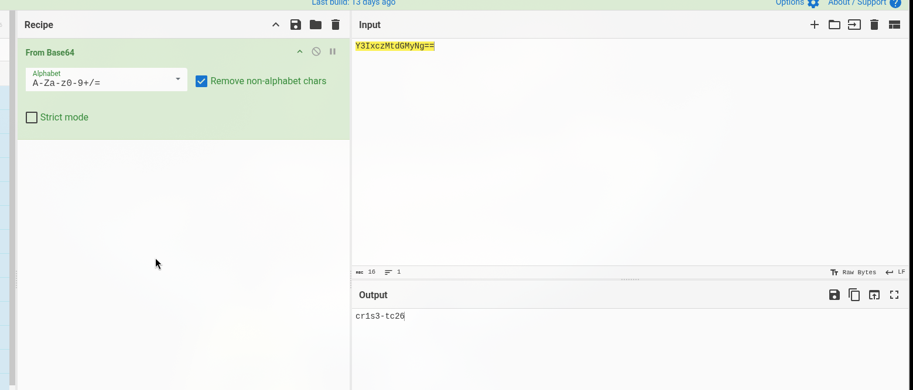
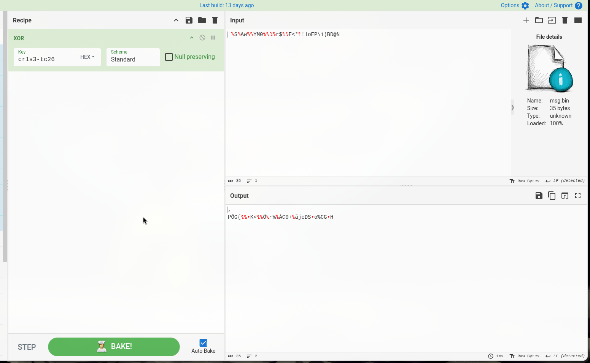

<div align="center">

<a href="https://git.io/typing-svg"></a>

</div>

# Double Bottom — STEGANOGRAPHY · 🔴 DIFÍCIL

- **Status:** ✅ RESOLVIDO — chave no chunk `tEXt` do PNG + mensagem XOR colada após o `IEND`
- **Pontos:** 175
- **Anexo:** `affiche_crise.png` (PNG 320×200 RGB, 13091 bytes; o enunciado chama de `poster_crise.png`)
- **Enunciado:** *"A "crisis management" poster is circulating. It hides two things: a key, stored neatly in the image, and a message, pasted right after. One is used to read the other."*
- **Flag:** `CyberZerk{St3g0_Pu1s_X0R_B13n_J0u3}`

---

## TL;DR

1. Chunk `tEXt` com keyword `cle` = `Y3IxczMtdGMyNg==`. Decodificado de base64: `cr1s3-tc26`.
2. 35 bytes colados depois do `IEND`.
3. XOR desses bytes com a chave repetida `cr1s3-tc26` (em UTF8) dá a flag.

## Análise

### 1. Estrutura do PNG

O enunciado descreve duas peças: uma guardada **na** imagem e outra colada **depois** dela. Por isso o recon começa pela lista de chunks do PNG. Cada chunk tem 4 bytes de tamanho, 4 de tipo, os dados e um CRC de 4 bytes.

```
offset  chunk   tamanho  conteúdo
8       IHDR    13       320x200, RGB 8 bits
33      tEXt    20       cle\0Y3IxczMtdGMyNg==
65      IDAT    12967    pixels comprimidos
13044   IEND    0        fim oficial do PNG
13056   ---     35       bytes binários colados
```

### 2. A chave: "stored neatly in the image"

O chunk `tEXt` guarda pares `keyword\0valor`. Os visualizadores não exibem esses pares, mas o `exiftool` mostra:

```
$ exiftool affiche_crise.png | grep -i cle
Cle                             : Y3IxczMtdGMyNg==
```

`cle` vem de *clé*, chave em francês. O `==` no fim é padding de base64:

```
$ echo 'Y3IxczMtdGMyNg==' | base64 -d
cr1s3-tc26
```



É a mesma família de vetor do [Trombinoscope](../Trombinoscope/WRITEUP.md): metadado plantado. No JPEG ele fica no EXIF; no PNG, num chunk `tEXt`.

### 3. A mensagem: "pasted right after"

O `IEND` é o fim do PNG, e o visualizador para nele. Tudo o que vem depois é ignorado; é o mesmo truque do [Facade smile](../FacadeSmile/WRITEUP.md). Desta vez, porém, os bytes colados não são legíveis:

```
$ tail -c 35 affiche_crise.png > msg.bin
$ od -An -tx1 msg.bin | head -1
 20 0b 53 16 41 77 11 11 59 4d 30 06 02 14 03 72
```

### 4. "One is used to read the other": XOR com chave repetida

Uma chave curta e uma mensagem curta e ilegível apontam para **XOR com chave repetida**: `msg[i] ⊕ chave[i mod 10]`. O XOR é a própria inversa: `(p ⊕ k) ⊕ k = p`. Por isso a mesma operação cifra e decifra.

Antes de decifrar tudo, testei com o texto conhecido. Toda flag começa com `CyberZerk{`, então:
- `0x20 ⊕ 'C' (0x43) = 0x63 = 'c'`
- `0x0b ⊕ 'y' (0x79) = 0x72 = 'r'`

Os dois primeiros bytes reproduzem o começo da chave (`cr...`), o que confirma a hipótese. Esse é o ataque de *known plaintext*: com o início da flag, daria até para recuperar a chave sem o chunk `tEXt`.

CyberChef: input = `msg.bin` (aberto como arquivo), operação *XOR*, Key = `cr1s3-tc26` no formato **UTF8**.

```
CyberZerk{St3g0_Pu1s_X0R_B13n_J0u3}
```

A flag fecha o tema: *stégo puis XOR, bien joué*, stego e depois XOR, bem jogado.

## O que não funcionou

- **Chave em HEX no CyberChef.** O campo Key do XOR vem em **HEX** por padrão. Nesse modo, o CyberChef descarta o que não é dígito hex: de `cr1s3-tc26` sobram `c1 3c 26`, uma chave de 3 bytes sem relação com a real. A saída virou lixo. A cifra estava certa; o erro era a interpretação da chave. Em **UTF8** (`63 72 31 73 33 2d 74 63 32 36`) funcionou.

  

## Conclusão

Este desafio combina três lições anteriores:
1. **Metadados** (Trombinoscope): `exiftool` também lê chunks `tEXt`/`zTXt`/`iTXt` de PNG.
2. **Dados após o fim do formato** (Facade smile): no PNG, depois do `IEND`.
3. **Uma camada de cripto simples por cima:** XOR com chave repetida, validado com *known plaintext* (`CyberZerk{`).

No CyberChef, sempre confira o formato da chave (HEX / UTF8 / Base64): é a armadilha mais comum do XOR.

---

## Apêndice — ferramentas

- `exiftool <png>`: mostra os chunks de texto do PNG (`tEXt`, `zTXt`, `iTXt`).
- `pngcheck -v <png>`: lista os chunks e acusa dados depois do `IEND`.
- `tail -c N <arq> > msg.bin`: extrai os N bytes finais sem corromper binário.
- `od -An -tx1 <arq>`: dump hex (alternativa ao `xxd`, que não está instalado aqui).
- CyberChef: *From Base64*; *XOR* (Key em UTF8).
- Teste de known plaintext: `msg[i] ⊕ 'CyberZerk{'[i]` revela os primeiros bytes da chave.
- `img/cle_base64.png`, `img/xor_chave_hex_errada.png`: prints do CyberChef.
