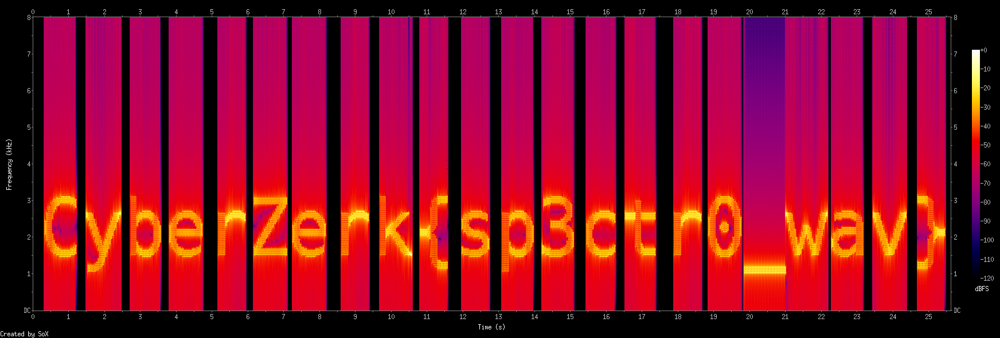

<div align="center">

<a href="https://git.io/typing-svg"></a>

</div>

# Hidden Frequency — STEGANOGRAPHY · 🟢 FÁCIL

- **Status:** ✅ RESOLVIDO — texto desenhado no espectrograma do áudio
- **Pontos:** 75 (dica não desbloqueada)
- **Anexos:** `message.wav` (WAV PCM 16 bits, mono, 16 kHz, 25,64 s), `README.txt` (enunciado em francês)
- **Enunciado:** *"Recording left on internal messaging. The ear only hears a noise... but the eye?"* (*"Enregistrement laissé sur la messagerie interne. L'oreille n'y entend qu'un bruit... mais l'œil ?"*)
- **Flag:** `CyberZerk{sp3ctr0_wav}`

---

## TL;DR

1. O enunciado ("o ouvido ouve ruído, mas e o olho?") e o título apontam para o **espectrograma**.
2. `sox message.wav -n spectrogram -x 1600 -y 513 -o spec.png` desenha a flag em letras entre ~1 e 3,5 kHz.

## Análise

### 1. Triagem

```
$ file message.wav && soxi message.wav
message.wav: RIFF (little-endian) data, WAVE audio, Microsoft PCM, 16 bit, mono 16000 Hz
Sample Rate    : 16000
Duration       : 00:00:25.64 = 410240 samples
```

Com 16 kHz de taxa de amostragem, a maior frequência representável é a **metade** dela: 8 kHz (limite de Nyquist). O espectrograma vai de 0 a 8 kHz no eixo vertical e de 0 a 25,6 s no horizontal.

### 2. Espectrograma

O espectrograma é uma FFT em janelas curtas: em cada fatia de tempo, mede quanta energia existe em cada frequência e pinta isso como uma coluna de pixels.

```bash
sox message.wav -n spectrogram -x 1600 -y 513 -o spec.png
```

- `-x 1600`: largura; ~62 colunas por segundo, as letras não ficam espremidas.
- `-y 513`: altura; cada linha vale ~15,6 Hz (8000/512).



A flag aparece escrita, uma letra por fatia de ~0,9 s, separadas por faixas pretas (silêncio).

### 3. Por que soa como ruído

Cada letra foi sintetizada como uma **soma de senoides**: cada pixel aceso do glifo vira uma frequência tocando durante a fatia de tempo daquela coluna. O espectrograma desfaz a soma e põe cada senoide de volta na sua linha, e a letra reaparece. Para o ouvido, dezenas de tons simultâneos sem relação harmônica soam como chiado.

### 4. Leitura

`CyberZerk{sp3ctr0_wav}`. Caracteres ambíguos conferidos no glifo:

- `0` (zero) em `sp3ctr0`: tem o ponto/barra interno do zero monoespaçado; o `C` inicial não tem.
- `3` em `sp3ctr0`: aberto à esquerda, diferente dos `e` de `Zerk`.
- `_`: uma única linha horizontal em ~1,1 kHz entre 20 e 21 s.

## O que não funcionou

Nada a registrar: a primeira hipótese (espectrograma) já resolveu. O manual `Audio-Signals` do Arsenal tinha os desvios prontos caso não resolvesse: FSK (`minimodem`), DTMF (`multimon-ng`), SSTV (`qsstv`) e Morse.

## Conclusão

Em stego de áudio, o primeiro passo é **olhar** o áudio: o espectrograma. Dica clássica no enunciado: "não se ouve, se vê". Para texto desenhado, não há nada a decodificar, só ler a imagem com resolução e contraste suficientes (`-x`/`-y`, `-z` para a faixa dinâmica).

---

## Apêndice — ferramentas

- `soxi message.wav`: taxa de amostragem e duração (define o eixo de frequência, até taxa/2).
- `sox message.wav -n spectrogram -x 1600 -y 513 -o spec.png`: renderiza o espectrograma; `-z 60` aumenta o contraste se o texto ficar fraco.
- [AudioCipher — Spectrogram](https://audiocipher.app/spectrogram): visualizador de espectrograma no navegador, útil para inspecionar áudio rápido sem instalar nada. Atenção: subir arquivos de um CTF em andamento para um site de terceiros pode expor a solução; prefira o `sox` local enquanto o CTF estiver aberto.
- Alternativas locais interativas: Audacity (faixa → *Spectrogram*) e Sonic Visualiser (*Layer → Add Spectrogram*).
- `img/spectrogram.png`: espectrograma gerado pelo `sox`.
