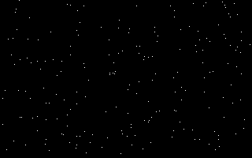

<div align="center">

<a href="https://git.io/typing-svg"></a>

</div>

# Plan de Charge — STEGANOGRAPHY · 🔴 DIFÍCIL

- **Status:** ✅ RESOLVIDO — LSB do azul em pixels sorteados por `numpy.random.default_rng(1337).permutation`
- **Pontos:** 236 (dicas não desbloqueadas)
- **Anexos:** `plan_de_charge.png` (PNG 320×200 RGB, 2062 bytes), `README.txt`
- **Enunciado:** *"Team Load Plan (PNG). Message hidden in low order bits, but not in the order you think. Seed: 1337. Length: 47 bytes."* (`README.txt`: *"Un message est caché dans les bits de poids faible, mais pas dans l'ordre que vous croyez. Graine du dispersoir : 1337. Longueur : 47 octets."*)
- **Flag:** `CyberZerk{lsb_d1sp3rs3_p4r_prng_pas_s3qu3nt13l}`

---

## TL;DR

1. A imagem tem só 4 cores. As 2 "extras" diferem das originais apenas no LSB do azul: são os bits `1` da mensagem (201 pixels).
2. A leitura sequencial (`zsteg`) dá lixo: os bits foram espalhados por um PRNG com semente 1337.
3. Oráculo: o sorteio certo precisa conter os 201 pixels acesos entre as 376 posições (47 × 8). Só `np.random.default_rng(1337).permutation(320*200)` passou (201/201).
4. Ler o LSB do azul nessa ordem, MSB primeiro, dá a flag.

## Análise

### 1. Recon do arquivo

O PNG tem apenas IHDR, um IDAT de 2005 bytes e IEND. Não há chunk de texto nem dados depois do `IEND`. Um PNG de 64.000 pixels ocupar só 2 KB significa cor chapada. Contagem de cores:

| Cor (R,G,B) | Pixels | Papel |
|---|---|---|
| (245, 245, 250) | 45479 | fundo |
| (70, 120, 200) | 18320 | barras do gráfico |
| (245, 245, **251**) | 146 | fundo com LSB do azul = 1 |
| (70, 120, **201**) | 55 | barra com LSB do azul = 1 |

Disso saem três conclusões:
- Só o canal **B** foi tocado. Se R/G fossem usados, apareceriam valores como 244 ou 71.
- Os 146 + 55 = **201 pixels** ímpares no azul são os bits `1` da mensagem.
- Os bits `0` são invisíveis, porque gravar 0 num valor par não muda nada.

201 uns em 376 bits é plausível para ASCII. O plano azul do Aperi'Solve mostra os pontos espalhados:



### 2. A ordem sequencial é falsa

```
$ zsteg plan_de_charge.png -b 1 -c b -o xy
b1,b,msb,xy  .. file: Adobe Photoshop Color swatch, version 0, 1 colors; ...
```

A leitura linha a linha dá quase só zeros, e o `file` interpreta isso como um formato qualquer. Os bits estão lá, mas fora de ordem: é o "pas dans l'ordre que vous croyez".

### 3. Semente = aleatoriedade reproduzível

Um PRNG é uma fórmula determinística: com a mesma semente, ele gera a mesma sequência.

```
$ python3 -c "import random; random.seed(1337); print(random.random()); random.seed(1337); print(random.random())"
0.6177528569514706
0.6177528569514706
```

O "dispersoir" sorteia as posições dos pixels a partir da semente, e o bit *i* vai no pixel sorteado *i*. Reproduzindo o sorteio, temos a ordem. O problema é que o enunciado dá a semente, mas não diz **qual** gerador nem **qual** função de sorteio.

### 4. Oráculo para testar hipóteses sem adivinhar texto

Os 376 pixels sorteados precisam conter **todos** os 201 pixels acesos. Com um sorteio errado, a expectativa é de 376/64000 × 201 ≈ **1,2** acertos por acaso. O oráculo derruba hipóteses na hora, sem depender de o texto "parecer certo".

| Hipótese | Gerador | Acertos |
|---|---|---|
| `random.sample(range(N), 376)` | Mersenne Twister (Python) | 0 / 201 |
| `random.shuffle(range(N))[:376]` | Mersenne Twister (Python) | 0 / 201 |
| idem, semente `'1337'` (string) ou índice por coluna | Mersenne Twister | 0–4 / 201 |
| `randrange(W), randrange(H)` sem repetição | Mersenne Twister | 0 / 201 |
| `np.random.RandomState(1337).permutation / choice` | Mersenne Twister (numpy legado) | 1–2 / 201 |
| `np.random.seed(1337); np.random.shuffle` | Mersenne Twister (numpy legado) | 1–2 / 201 |
| `np.random.default_rng(1337).choice(N, 376, replace=False)` | PCG64 | 2 / 201 |
| **`np.random.default_rng(1337).permutation(N)[:376]`**, índice linha a linha | **PCG64** | **201 / 201** |

O mesmo `1337` gera sequências totalmente diferentes em cada biblioteca. O `default_rng` do numpy usa o PCG64, não o Mersenne Twister, e por isso as tentativas com o `random` do Python nunca chegariam lá.

### 5. Extração

Índice linha a linha (`x = p % W`, `y = p // W`), LSB do azul, bits MSB primeiro:

```bash
uv run -q --no-project --with numpy --with pillow python -I -c "
import numpy as np
from PIL import Image
im=Image.open('plan_de_charge.png').convert('RGB');W,H=im.size;px=im.load()
ordem=np.random.default_rng(1337).permutation(W*H)[:47*8]
bits=''.join(str(px[int(p)%W,int(p)//W][2]&1) for p in ordem)
print(bytes(int(bits[i:i+8],2) for i in range(0,len(bits),8)))
"
b'CyberZerk{lsb_d1sp3rs3_p4r_prng_pas_s3qu3nt13l}'
```

O `uv run --with` cria um ambiente descartável com numpy, que não estava instalado no sistema.

A flag fecha o tema: *LSB dispersé par PRNG, pas séquentiel*, LSB espalhado por PRNG, não sequencial.

## O que não funcionou

- **Leitura sequencial (`zsteg -b 1 -c b -o xy`).** Saiu lixo, como o enunciado avisava. Serviu para confirmar que o problema era só a ordem.
- **`random` do Python (`sample` e `shuffle`).** Foram as duas primeiras hipóteses, por serem as mais comuns em scripts de CTF. Deram 0/201: falsificadas por completo.
- **Variantes do Mersenne Twister.** Semente como string, índice por coluna, sorteio de (x, y) com `randrange`/`randint`, e o numpy legado (`RandomState`, `np.random.seed`). Todas ficaram em 0–4/201, o nível do acaso.
- **`default_rng(1337).choice(N, 376, replace=False)`.** É o gerador certo com a função errada: `choice` sem reposição não consome o PRNG do mesmo jeito que `permutation`, então a sequência muda. Deu 2/201.
- **Aperi'Solve.** Mostrou o plano azul, mas é um site de terceiros que pode guardar o upload; com o CTF aberto, o certo é fazer isso localmente (`zsteg`, `stegsolve`, Python).

## Conclusão

1. **Em imagem chapada, LSB modificado aparece na contagem de cores:** valores vizinhos (250/251, 200/201) entregam o canal usado e os bits `1`.
2. **"Semente" no enunciado não identifica o PRNG.** `random` (Mersenne Twister), `numpy` legado e `numpy.default_rng` (PCG64) dão sequências diferentes; `sample`, `shuffle`, `choice` e `permutation` também.
3. **Teste as hipóteses contra um oráculo independente do texto:** aqui, "os 201 pixels acesos precisam estar entre os sorteados". O acaso dá ~1; a hipótese certa dá 201.

---

## Apêndice — ferramentas

- Contagem de cores com Pillow: `Counter(im.getdata()).most_common()` revela os valores com LSB alterado.
- `zsteg <png>`: leituras LSB em ordens fixas; serve para descartar a ordem sequencial.
- `uv run -q --no-project --with numpy --with pillow python -I -c '...'`: roda numpy sem instalar no sistema.
- Template mental: *semente no enunciado → listar as famílias de PRNG/funções de sorteio → testar cada uma contra o oráculo → extrair*.
- `img/plano_azul_lsb.png`: plano LSB do azul (Aperi'Solve).
