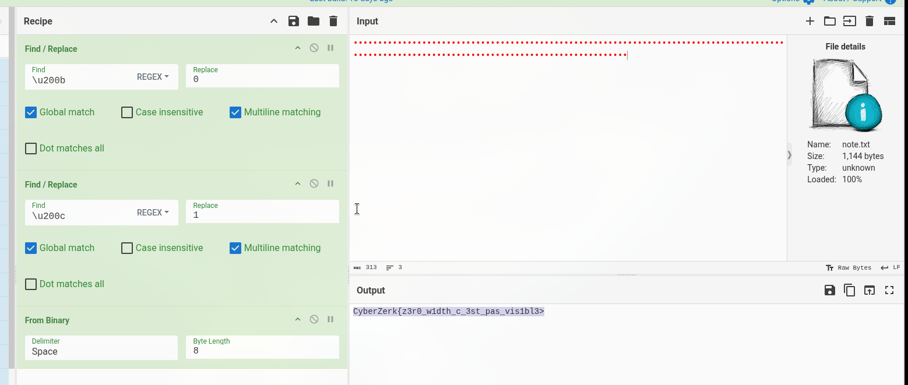

<div align="center">

<a href="https://git.io/typing-svg"></a>

</div>

# Workspaces — STEGANOGRAPHY · 🟡 MÉDIO

- **Status:** ✅ RESOLVIDO — binário em caracteres Unicode de largura zero (U+200B / U+200C)
- **Pontos:** 102 (dicas não desbloqueadas)
- **Anexos:** `note.txt` (1144 bytes), `README.txt`
- **Enunciado:** *"An innocuous memo that 'weighs' more than its text."* (`README.txt`: *"Cette note parait anodine. Pourtant elle 'pèse' plus que son texte."*)
- **Flag:** `CyberZerk{z3r0_w1dth_c_3st_pas_vis1bl3}`

---

## TL;DR

1. `note.txt` tem 1144 bytes, mas o texto visível ocupa ~208 bytes.
2. A diferença são 312 caracteres invisíveis depois de `Note `: U+200B (ZWSP) e U+200C (ZWNJ).
3. Com ZWSP = 0, ZWNJ = 1 e 8 bits por byte, saem 39 bytes ASCII, que formam a flag.

## Análise

### 1. O "peso" do texto

```
$ cat note.txt
Note de service — RH Tricatel

Chers collègues, la direction vous remercie pour votre implication continue durant cette
période de restructuration. Un point d'étape sera organisé la semaine prochaine.
```

O `cat` mostra uma nota comum, mas o arquivo tem 1,1 kB. A IDE denunciou: ela destaca caracteres Unicode suspeitos, e a linha 1 ficou com uma faixa marcada logo depois de `Note`.

Contagem dos caracteres não visíveis:

| Caractere | Código | Qtd. | Bytes UTF-8 |
|---|---|---|---|
| ZERO WIDTH SPACE (ZWSP) | U+200B | 144 | `e2 80 8b` (3) |
| ZERO WIDTH NON-JOINER (ZWNJ) | U+200C | 168 | `e2 80 8c` (3) |

São 312 × 3 = 936 bytes invisíveis, mais ~208 de texto, totalizando 1144 bytes: esse é o "peso" do enunciado. O título é trocadilho com *whitespace*.

### 2. Hipótese: binário com dois símbolos

Dois símbolos diferentes indicam binário. Os números ajudam: 312 ÷ 8 = **39 bytes** exatos, tamanho plausível para uma flag.

Teste com o primeiro byte, antes de decodificar tudo. Os 7 primeiros símbolos são `ZWSP ZWNJ ZWSP ZWSP ZWSP ZWSP ZWNJ`; com ZWSP = 0 e ZWNJ = 1, fica `0100001?`. `01000011` = `C`, a primeira letra de `CyberZerk`. O mapeamento está certo.

### 3. Decodificação no CyberChef

Receita:
1. *Find / Replace*: `​` → `0` (regex, global)
2. *Find / Replace*: `‌` → `1` (regex, global)
3. *From Binary* (byte length 8)



Saída: `CyberZerk{z3r0_w1dth_c_3st_pas_vis1bl3>`.

### 4. O último byte

A saída termina em `>` e não em `}`. Comparando os bits:

```
'}' = 0x7D = 01111101
'>' = 0x3E = 00111110   ← '}' deslocado 1 bit para a direita
```

O byte codificado é o `}` correto sem o último bit e com um 0 sobrando na frente. Provável erro do encoder do autor; todos os 38 bytes anteriores saíram certos. Troquei `>` por `}` e a plataforma aceitou.

A flag fecha o tema: *zéro width, c'est pas visible*, largura zero não é visível.

## O que não funcionou

- A primeira decodificação deixou o último caractere errado (`>`). Não era erro de mapeamento, porque o resto da flag estava certo: era um bit deslocado no byte final. Corrigido pelo formato conhecido da flag.
- Ferramentas avaliadas e descartadas para este caso: `stegsnow` (só lê espaços e tabs no fim das linhas, esquema SNOW) e `stegcloak` (usa largura zero, mas comprime e cifra o conteúdo num esquema próprio).

## Conclusão

Quando um texto "pesa" mais do que mostra, compare o tamanho em bytes com o texto visível e conte os caracteres fora do ASCII imprimível. Caracteres de largura zero (U+200B, U+200C, U+200D, U+FEFF) somem no terminal, mas ocupam 3 bytes cada. Com dois símbolos distintos, o esquema costuma ser binário; valide o mapeamento no primeiro byte antes de decodificar tudo.

---

## Apêndice — ferramentas

- **CyberChef** (de preferência a versão offline, um HTML único do GitHub, enquanto o CTF estiver aberto): *Find/Replace* ×2 + *From Binary*.
- Em shell puro:
  ```bash
  sed 's/\xe2\x80\x8b/0/g; s/\xe2\x80\x8c/1/g' note.txt | tr -cd 01 | perl -lpe '$_=pack"B*",$_'
  ```
- Para ver os invisíveis: `cat -A note.txt` (mostra os bytes UTF-8 como `M-bM-^@M-^K`) ou uma IDE que destaque Unicode suspeito.
- Outros esquemas de whitespace: `stegsnow` (SNOW: espaços e tabs no fim das linhas) e a linguagem *Whitespace*.
- `img/cyberchef.png`: a receita usada.
