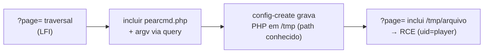

<div align="center">

<a href="https://git.io/typing-svg"></a>

</div>

# Le Filtre Magique — WEB · 🟣 EXTRÊME

- **Status:** ✅ RESOLVIDO — LFI (`?page=`) com traversal livre, transformada em execução de código. Fechado pela técnica **`pearcmd.php`** (escrita de um arquivo PHP num caminho conhecido), que dispensa adivinhar o nome do arquivo da nota. A solução **pretendida** era *session poisoning* (`?note=` → `$_SESSION` gravado em `/tmp/sess/sess_<SID>`), confirmada depois ao ler o fonte pela própria execução.
- **Pontos:** 250 (+25 troféu *Extrême*)
- **Flag:** `CyberZerk{LFI_c0ntr41nt3_p01s0n_d3_s3ss10n_v3rs_rc3}`
- **Alvo:** `filtre-magique.cyberzerk.fr` (HTTPS via Caddy; `php -S` interno na `:8080`)
- **Enunciado:** *"Lecteur de pages d'aide (`?page=`) + bloc-notes (`?note=`). Un filtre maison rejette les wrappers. Obtenez une exécution de commande."*
- **Dica do app:** *"j'ai ajouté un filtre maison contre les wrappers. Bricolé à 2h du mat, ça devrait tenir."* → filtro improvisado, incompleto de propósito.

---

## TL;DR

1. `?page=` é `include(__DIR__.'/pages/'.$page)` — **traversal livre, sem append de `.php`** → leitura arbitrária de arquivos **e** execução de qualquer PHP que seja incluído.
2. O "filtre maison" é `preg_match('#(php|data|expect|zip|phar|glob|http)\s*:#i', $page)` — uma blacklist de esquemas que, na prática, é **decorativa**: como o sink sempre prefixa `/app/pages/`, nenhum wrapper fica na posição 0, então nem os esquemas "liberados" seriam interpretados. O nome é irônico — o filtro é mágico por não fazer nada.
3. O único vetor que atravessa o prefixo é `../` para arquivos reais.
4. **Caminho pretendido:** gravar PHP numa sessão (`?note=` popula `$_SESSION`, serializado em `/tmp/sess/sess_<SID>`) e incluí-la.
5. **Caminho usado:** a técnica `pearcmd.php` — gravar um arquivo PHP num caminho **conhecido** (`/tmp`) e incluí-lo, sem depender do arquivo opaco da nota.
6. RCE como `player` (uid 10001). Flag num diretório de nome aleatório em `/srv`.

## Anatomia

### `?page=` — o include

O fonte (recuperado depois, via execução) é minimalista:

```php
<?php
session_save_path('/tmp/sess'); @mkdir('/tmp/sess', 0700, true);
session_start();
if (isset($_GET['note'])) { $_SESSION['note'] = $_GET['note']; echo "Note enregistrée.\n"; }
$page = $_GET['page'] ?? 'accueil.php';
if (preg_match('#(php|data|expect|zip|phar|glob|http)\s*:#i', $page)) {
    echo "Wrapper interdit par le filtre.\n"; exit;
}
include __DIR__ . '/pages/' . $page;
```

- **Base:** `/app/pages/`. **Sem `.php` forçado**, **traversal `../` livre** → leitura de qualquer arquivo texto (impresso verbatim; PHP fora de `<?php ?>` não executa) **e** execução se o conteúdo tiver tags PHP.
- O include vaza o path em `Warning` quando o arquivo não existe — útil pra confirmar a base e o número da linha.

### O filtro é teatro

A blacklist bloqueia `php data expect zip phar glob http`, mas o prefixo `/app/pages/` já mata todo wrapper sozinho: PHP só interpreta um esquema se o caminho **começa** com `esquema://`, e aqui ele sempre começa com `/app/pages/`. Confirmado no alvo: `?page=file:///etc/passwd` vira `include(/app/pages/file:///etc/passwd): Failed to open stream`. Logo, o filtro é irrelevante — a vuln real é o traversal.

## Da LFI para a execução

Faltava gravar PHP num **caminho conhecível** e incluí-lo.

### Caminho pretendido (session poisoning)

O fonte confirma a intenção do autor (e a própria flag a soletra: *"poison de session vers RCE"*): `?note=` grava `$_SESSION['note']` e a sessão é serializada em `/tmp/sess/sess_<SID>`. Bastaria mandar uma nota com tags PHP e incluir `../../tmp/sess/sess_<SID>` (o `<SID>` vem do cookie `PHPSESSID`).

### Caminho usado (pearcmd)

A imagem oficial do PHP traz `/usr/local/lib/php/pearcmd.php` no `include_path`, e as imagens `php:*` sobem com `register_argc_argv=On`. Com isso, incluir o `pearcmd.php` com argumentos passados pela query string faz o seu subcomando `config-create` **gravar um arquivo de configuração num caminho escolhido**, com um prefixo controlado embutido no conteúdo. Esse prefixo foi usado para colocar um pequeno trecho PHP no arquivo, gravado em `/tmp`.

Incluir esse arquivo via `?page=../../../../../../tmp/<arquivo>` deu execução. Detalhe de PHP 8: a chave do array precisa ser literal (`$_GET["cmd"]` ou `$_GET[0]`) — bareword sem aspas (`$_GET[cmd]`) é **fatal error** ("Undefined constant") no 8.x, diferente do 7.x onde virava warning.



## Pós-exploração (dentro do escopo)

RCE confirmada como `player` (uid 10001) **dentro do container próprio do challenge** (`.dockerenv` presente, hostname aleatório). Isso **é** o objetivo do enunciado ("obtenez une exécution de commande") — nenhuma fronteira cruzada (Hyperion/Cloudflare/outros challenges), então nada de divulgação responsável aqui; é o solve normal.

- `find / -iname '*flag*'` → **vazio** (flag não tem "flag" no nome).
- `env`, `/home/player`, `/root` (700, inacessível) → sem flag.
- `/srv/` → **`5fdf2c50c2664462a23f9623/`**, dir root `755` de nome hex aleatório (escapa de `find -name`). A flag estava ali.

```bash
# extração final (resposta vem repetida ~12× pelo blob do pearcmd; grep resolve)
curl ... '?page=../../../../../../tmp/<shell>&cmd=ls+-la+/srv/<hex>;cat+/srv/<hex>/*' \
  | grep -aoE 'CyberZerk\{[^}]+\}' | head -1
# CyberZerk{LFI_c0ntr41nt3_p01s0n_d3_s3ss10n_v3rs_rc3}
```

## O que não funcionou (trilha honesta)

| Hipótese | Resultado | Por quê |
|---|---|---|
| Wrappers (`data://`, `php://filter`, `expect://`, `file://`, `compress.zlib://`…) | ✗ | o prefixo `/app/pages/` impede qualquer esquema na posição 0; o filtro é redundante |
| Flag legível por nome (`/flag`, `/flag.txt`, `/app/flag`…) + `find -name '*flag*'` | ✗ | a flag fica em `/srv/<hex>/`, nome aleatório |
| `?note=` controla o **nome** do arquivo (sweep de ~18 campos: `nom titre fichier name filename …`) | ✗ | `?note=` só grava em `$_SESSION`; não existe campo de nome |
| `?note=` → sessão, sweep de `save_path` em `/tmp`, `/app`, `/var/lib/php`… | ✗ **(quase!)** | a tese de session poisoning estava **certa**, mas o `save_path` real é `/tmp/sess` (subdir criado em runtime) — o sweep testou `/tmp`, não `/tmp/**sess**`. Esse foi o ponto cego que travou o black-box |
| `session.upload_progress` em race | ✗ | o `php -S` bufferiza o corpo inteiro do POST antes de entregar à app → não há janela "durante o upload"; além disso `enabled=Off` por default em 8.2+ |
| Ler o fonte do `index.php` por LFI antes da RCE | ✗→✅ | como include executa o PHP, não dava pra *ler* o fonte pela LFI; só depois da RCE (`cat /app/index.php`, world-readable) ele foi recuperado e confirmou tudo |

> **Lição:** a hipótese de *session poisoning* nunca foi falsificada de verdade — o que falhou foi o **save_path assumido**. Um sweep que incluísse subdiretórios de `/tmp` (ou que lesse `/proc/self/maps`/`open_basedir`/o fonte) teria fechado pelo caminho pretendido. O `pearcmd` contornou isso por não depender do path da nota.

## Conclusão

Vuln: **LFI por traversal em `?page=`** (filtro de wrappers inútil pelo prefixo). Dois caminhos até RCE: o pretendido (envenenar a sessão em `/tmp/sess` e incluí-la) e o usado (`pearcmd.php` + `register_argc_argv` para gravar PHP num path conhecido). Execução como `player` no container do próprio challenge; flag em `/srv/<hex>/`.

**Flag:** `CyberZerk{LFI_c0ntr41nt3_p01s0n_d3_s3ss10n_v3rs_rc3}`
